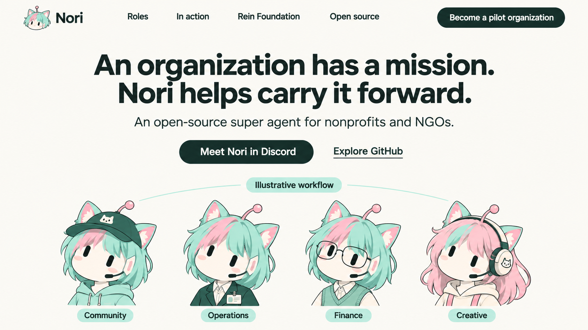
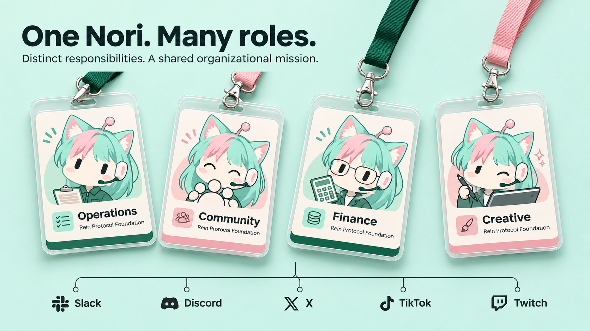
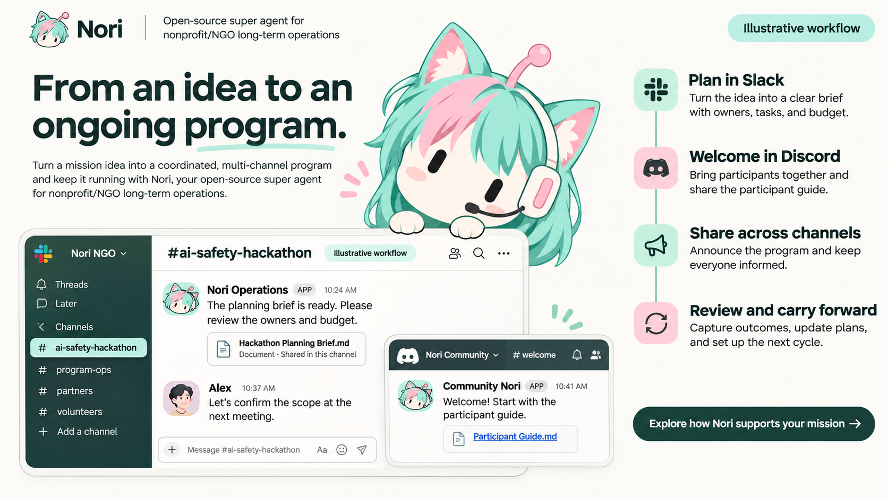
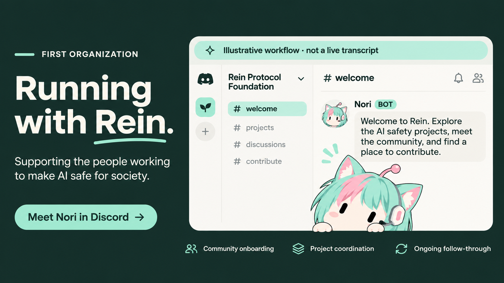
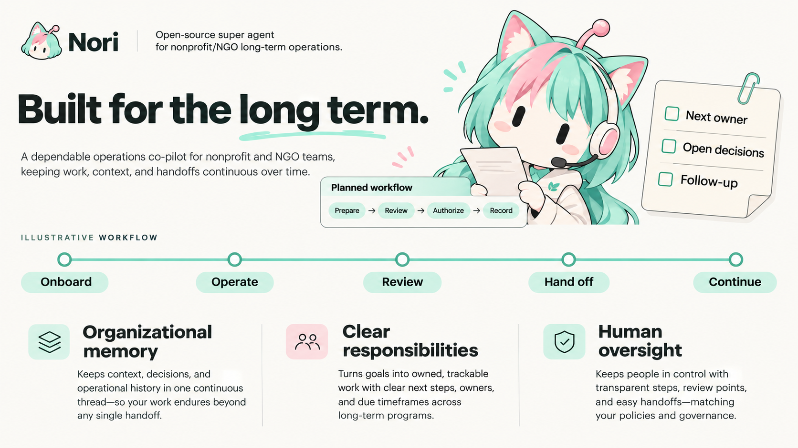
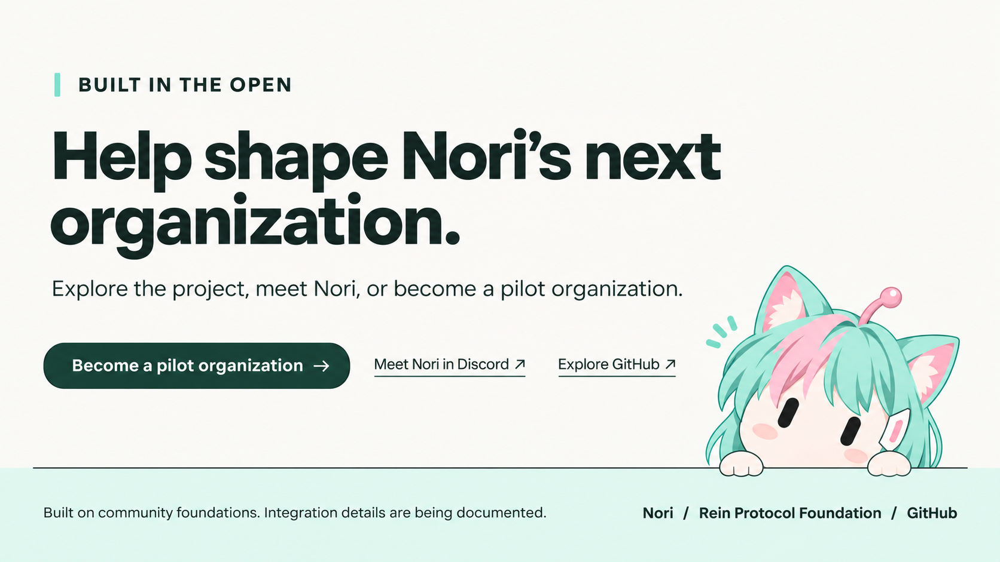
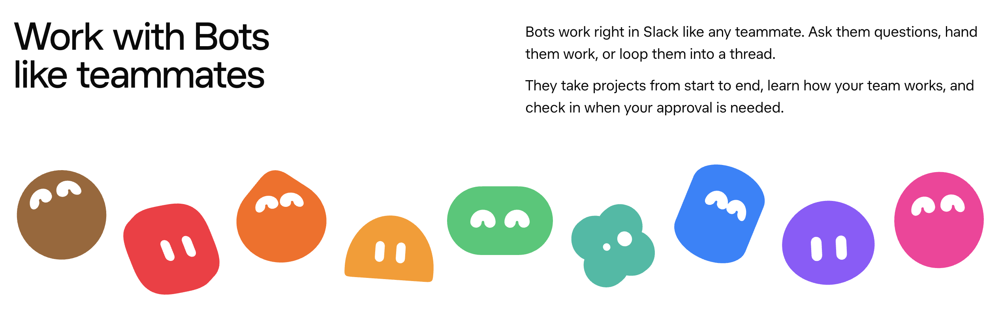
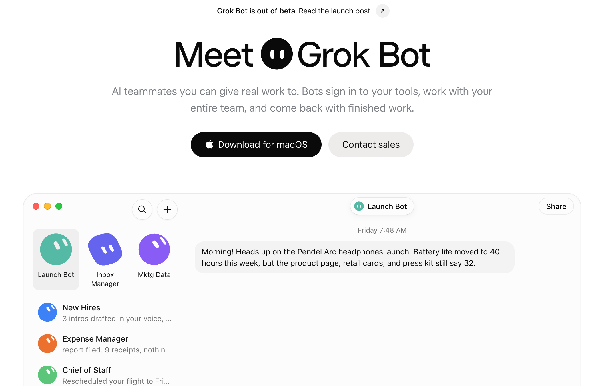
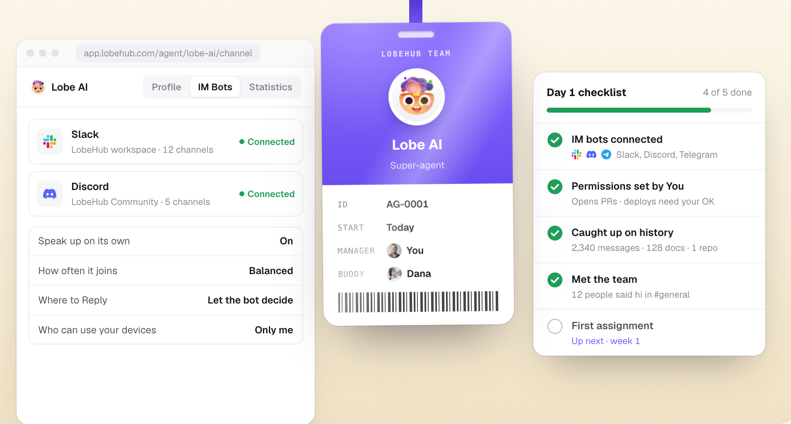

# Nori Website — Early Design PRD v0.1

> 历史稿：用户认为本版过于软萌、色彩偏淡、软件界面失真。视觉方向已由 [v0.2](design-prd-v0.2.md) 替代；本文件与图片保留用于对照，不作为当前视觉实施依据。

日期：2026-11-11 · Owner：Codex / Rein Protocol Foundation · Task：WEBSITE-DESIGN-01

状态：设计评审稿。交付为内容、UI 视觉稿与交互规格，不包含网站代码、部署或域名迁移。英文为首版网站语言，本文用中文说明设计决策。

## 1. 产品叙事与目标

Nori 是面向组织长期运营与发展的 super agent，优先服务 nonprofit 与 NGO。Rein Protocol Foundation 是主案例，组织使命是推进 AI safety，使 AI agent 对人与社会更安全。

核心表达：**An organization has a mission. Nori helps carry it forward.**

读者应依次理解：Nori 是谁 → 多种职责如何协作 → 一项组织工作如何跨渠道持续推进 → Rein 如何成为体验入口 → 长期运作需要什么 → 如何体验、参与开源或申请试点。

- 主转化：Meet Nori in Discord。
- 机构转化：Become a pilot organization。
- 开发者入口：Explore GitHub，指向 agent 产品仓库，而不是默认指向网站源码仓库。
- 不设置 App 下载、一行安装、虚构产品 dashboard、定价或无人值守经营承诺。
- 能力现状为“已有能力与愿景混合”。设计稿不是功能验收记录。

## 2. 视觉系统

方向：有角色温度的组织级产品。大字号、清晰排版、适量留白形成专业感；Nori 形象提供辨识度。叙事沿组织工作周期展开，工牌是唯一明显的材质变化。

| 项目 | 规格 |
| --- | --- |
| 页面底色 | Warm white `#FAFAF6` |
| 正文与主按钮 | Ink green `#182C29` |
| 品牌辅助色 | Mint `#A4E6D8` |
| 角色点缀 | Blush `#F3B5C5`，不用于浅底小字 |
| 字体方向 | Manrope，fallback 为系统 sans-serif；实际使用前确认字体许可并自托管 |
| 桌面版式 | 1440px 设计基准，内容最大宽 1280px，左右至少 48px |
| 字号 | H1 72/78px、H2 48/56px、正文 18/28px、标注 14/20px |
| 移动端 | 390px 基准，左右 20px；H1 40/46px、H2 32/38px、正文 16/25px |
| 间距 | 8px 基准；桌面段落上下 96–120px，移动端 56–72px |
| 控件 | 按钮高至少 48px；内容面板圆角 20px；细线而非强阴影 |

四种主要组件：角色工牌、聊天界面片段、工作周期时间线、编辑式案例区。允许轻量淡入与工牌倾斜反馈；不使用自动轮播、无限 logo 跑马灯或持续漂浮动画。

## 3. 六个页面区段

以下六张均为独立横向 UI 概念图。图中文字、图标和细节是设计参考；实现应以本文规格为准，不能直接把整张图当成网站。

### 01 · Meet Nori

居中标题与四种分身组成开场。导航：Roles / In action / Rein Foundation / Open source；右侧试点入口。

正式文案：

> An organization has a mission.
> Nori helps carry it forward.
>
> An open-source super agent for long-term operations and growth, built for nonprofits and NGOs.

主 CTA 为 Meet Nori in Discord，次链接 Explore GitHub。导航试点按钮使用描边，避免与主 CTA 争夺注意力。移动端导航折叠，CTA 纵向排列，四个角色为 2×2，不裁切脸部。

**生成稿修订项：** 首屏误加了 Illustrative workflow 标签，正式稿删除；角色介绍本身不需要演示标签。副标题采用上方完整文案。开源定位在发布前与实际许可证状态核对。

### 02 · One Nori. Many roles.

保留猫耳、长圆眼睛、耳机和统一脸型。工牌承载 Role / Organization / Channels / Responsibilities，不能加入虚构雇佣日期或人员身份。

| 分身 | 形象方向 | 主要职责 | 渠道表达 |
| --- | --- | --- | --- |
| Operations | 薄荷发、深绿外套、工牌 | 日常任务、入离职、handoff、会议、董事会流程 | Slack 为主 |
| Community | 薄荷发、棒球帽、亲切表情 | onboarding、答疑、筹款、hackathon、conf talk | Discord 为主 |
| Finance | 薄荷发、眼镜、针织背心 | 预算、审计材料、资金记录、财务工作流 | 授权内部渠道及业务系统 |
| Creative | 粉色主发、薄荷挑染、耳机 | 活动宣传、社媒互动、短视频、直播素材 | X / TikTok / Twitch |

角色与渠道为多对多关系。图中的共用连接线仅表示工作渠道概念，不代表所有渠道已接通，更不表示所有分身共享所有数据。交互选中角色后，显示其职责与相关渠道；键盘和触摸均可操作，首屏默认 Operations。移动端工牌 2×2，说明放在其下，连接图改为文字列表。

**生成稿修订项：** 第二张的帽子、发色未完全遵循第一张，后续独立角色素材以本表为准；不直接从工牌图裁图作为最终头像。正式渠道图每条连接需按真实状态标记，不使用全绿 Connected。

### 03 · From an idea to an ongoing program

主故事：AI safety hackathon。以 Slack 的计划讨论作为大画面，Discord 的欢迎与指引为辅助片段。后续同一容器可切换四个步骤：

1. **Plan in Slack**：目标、负责人、预算草案与会议决策。
2. **Welcome in Discord**：参与指南、答疑、志愿者与活动协调。
3. **Share across channels**：活动宣传稿、X 的相关讨论回复、TikTok 短视频与直播预告。
4. **Review and carry forward**：成果归档、资助人更新、财务材料与下一次活动的改进。

演示脚本：Nori Operations：“The planning brief is ready. Please review the owners and budget.” 示例成员 Alex：“Let’s confirm the scope at the next meeting.” Community Nori：“Welcome! Start with the participant guide.” 所有人名与内容均为虚构示例。

显示固定的 **Illustrative workflow** 标注。切换步骤只改变演示片段，不自动播放。每个步骤显示平台与输出物，强调从准备到跟进的过程。移动端按钮换行，聊天内容保持可读，不缩小整张桌面截图。

**生成稿修订项：** 删除生成器额外添加的重复页头与长 CTA；workspace 名称统一为 Rein Protocol Foundation。宣传场景使用虚构帖子，不伪造 Elon、Sam Altman、CZ 的回应、点赞或背书。当前视觉稿覆盖前两个步骤，社媒和复盘的独立界面图属于下一轮细化素材。

### 04 · Running with Rein

深绿底与浅色 Discord 片段形成页面的主要节奏变化。

> Running with Rein.
> Supporting the people working to make AI safe for society.

CTA：Meet Nori in Discord。组织介绍与演示界面分开：Foundation 是真实案例主体，但这张对话不是实际聊天记录。图上保留 **Illustrative workflow · not a live transcript**。

真实案例后续结构为“组织背景 → 工作任务 → Nori 做了什么 → 人如何参与 → 结果与时间 → 来源”。没有证据时不展示运营天数、任务量、资金规模、替代人数或自动化比例。移动端先标题与组织背景，再界面，最后 CTA；不截掉演示标签。

当前可展示来源：用户提供的 Foundation 产品背景与仓库中可核对的能力描述。尚未收集新的真实运营记录，因此本节是案例呈现设计，不是已完成的案例报道。

### 05 · Built for the long term

时间线：Onboard → Operate → Review → Hand off → Continue。三条支撑内容：

- **Organizational memory** — Carry decisions and context into the next cycle, within the right access boundaries.
- **Clear responsibilities** — Keep owners, open decisions, and next steps visible.
- **Human oversight** — Match actions to the organization’s policies and authority.

交接工件展示 Next owner / Open decisions / Follow-up。移动端改为纵向时间线，三个支撑点顺序展开。

财务内容通过本区段的展开项呈现，不用银行 logo 墙暗示已上线：

| 业务范围 | 设计中的内容 | 发布前核对 |
| --- | --- | --- |
| 链上财务 | BNB Chain、Ethereum、Solana，智能合约、资金查看与授权操作 | 各链连接与实际操作证据，不能笼统声称全支持 |
| 银行与支付 | Chase、Mercury 等银行服务，以及支付流程 | 接入方式、支持范围与授权边界 |
| 企业设立服务 | Stripe Atlas | 单独分类，不称为银行连接 |
| 组织财务 | 审计材料、支出、筹款、融资、资助人或投资人关系、税务材料 | 每项区分可运行能力与规划；不把材料准备说成已完成申报 |

演示流程：Prepare → Review → Authorize → Record，标记 Planned workflow。图中文字“one continuous thread”不能进入正式文案，容易暗示跨权限信息混用；采用本节的精确文案。

### 06 · Built in the open

> Help shape Nori’s next organization.
> Explore the project, meet Nori, or become a pilot organization.

主 CTA：Become a pilot organization；次级链接：Meet Nori in Discord / Explore GitHub。页脚归属 Rein Protocol Foundation。

技术基础内容：用户指定 OpenClaw、DeepSeek Harness、MagPie 为 Nori 的社区基础；后续逐一确认准确项目名、官方仓库、许可证与实际使用关系。用短段落和项目链接致谢，不制作合作伙伴或认证徽章。设计参考致谢仅在本文最后，不进入官网营销页。

当前不设计数据采集后端。试点入口目标在发布前确定为有效联系渠道或申请表；不能上线空链接、模拟成功提交或不接收数据的表单。

## 4. 能力证据与内容状态

| 标记 | 使用条件 | 视觉规则 |
| --- | --- | --- |
| In use | 有可公开的运行记录，并核对功能边界 | 标明时间与来源，不能只靠绿色圆点 |
| Illustrative workflow | 合成消息、重建界面或未来工作流演示 | 界面附近始终可见，不放在隐藏 tooltip |
| Planned | 无运行证据或已明确属未来能力 | 明确说明是产品方向 |

当前六张均为概念设计，不含已验证的经营成果。董事会投票、社区 onboarding、资源发现等能力可从 agent 仓库进一步选材；真实支付、报税、金融机构连接、社媒发布等仍需逐项核实。产品能力不因网站设计而获得验收。

## 5. 交互、移动端与可访问性

- 桌面导航锚点滚动；移动端菜单使用可关闭抽屉，Esc 关闭并恢复焦点。
- 四角色选择与四工作步骤均提供明确选中态及键盘操作；不依赖 hover 才显示内容。
- 工牌 hover 仅轻微倾斜，键盘 focus 使用边框；减少动态偏好下关闭倾斜与入场位移。
- 真实文本与按钮必须以 HTML 实现，生成图只提供视觉方向。聊天文字另有可读文本，不依赖图片 OCR。
- 正文对比度至少 4.5:1，大字至少 3:1；按钮和链接焦点可见；不单凭颜色区分状态。
- 320、390、768、1440px 下检查横向溢出、标题断行、CTA、工牌与演示标签。移动端不保留桌面重叠面板。
- 图片提供尺寸和替代文本；装饰角色使用空 alt；底部素材延迟加载。最终图片需按显示尺寸导出，不原样加载六张大稿。

## 6. 素材交接与当前验收

已交付：六张横向区段图、三张用户参考图、现有 Nori 头像副本、本文与完整生成提示词。生成方式为内置 image_gen；工具未返回可验证模型版本，因此不能确认为 GPT Image 2。提示词见 [prompts.md](prompts.md)。

视觉检查：六张统一薄荷绿/粉色/墨绿方向、角色身份可辨认、主要 CTA 与英文标题清晰。已发现的多余标签、角色配饰差异、重复页头与界面模拟偏差已在各节记录。当前状态为 v0.1 评审稿，不是最终像素规格或生产素材。

需要用户后续提供或确认的材料，不阻塞本轮设计：

1. 可公开、脱敏的 Discord 欢迎/答疑/活动片段，以及 Slack 任务协调/投票/交接片段。隐藏姓名、邮箱、内部频道、金额和私人内容。
2. 希望展示的真实 X 帖子或其他社媒作品；没有实际记录时继续使用明确标记的演示。
3. 有效 Discord 邀请链接、试点申请接收地址或表单。
4. 希望公开的运营结果及其证据、技术基础项目链接和许可证选择。

测试边界：本轮仅做本地文件、引用与视觉检查；无网站构建、浏览器交互、真实工作流或部署验收。未提交或推送此次设计文件，未改变 DNS、Vercel 或现有 dashboard。

下一步：用户评审视觉方向，优先确认角色画风与案例信息密度，再做独立角色素材、社媒步骤及移动端视觉稿。网页实现另行启动。

## 7. 早期设计参考与致谢

以下三张为用户上传的参考截图，仅作内部设计研究，版权归原权利方；不作为官网素材或暗示合作关系。正式公开文档或推送参考图片前确认使用范围。借鉴信息表达方式，不复制角色、品牌视觉或整页布局。

### Grok Bot — 角色与团队协作

采用：多个形象共同表达团队协作，保留角色趣味和辨识度。转换为 Nori 的统一猫耳头像家族；不采用 Grok 的几何角色。

### Grok Bot — 首屏层级

采用：大标题、短说明、清晰 CTA 与工作画面。Nori 替换为 Discord 体验、GitHub 和机构试点，不复用下载入口或独立 App 壳。来源：[Grok Bot](https://x.ai/bot)。

### LobeHub — 工牌与渠道连接

采用：工牌建立职责感、渠道示意解释工作触点。转换为四种 Nori 分身及多对多职责关系，不借鉴其 agent 头像，也不虚构配置界面或 Connected 状态。来源：[LobeHub](https://lobehub.com/)。

### Nori — 现有身份资产

来源：nori-agent 的 workspace/avatars/rein-agent.png。用于六次生成的身份参考。新增服装、配饰、表情和配色属于本轮概念探索，最终角色素材需单独导出和统一校准。
