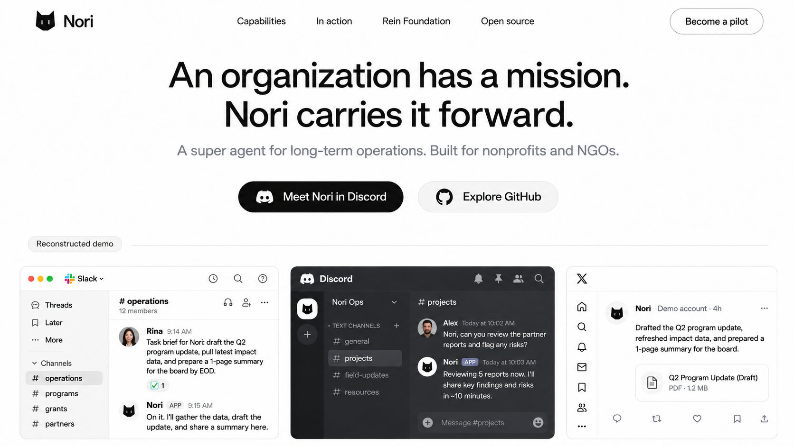
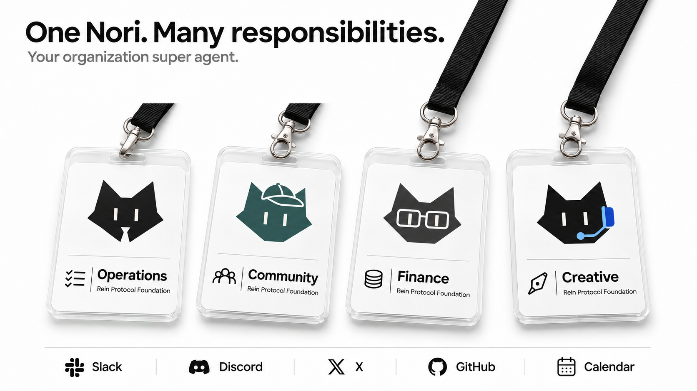
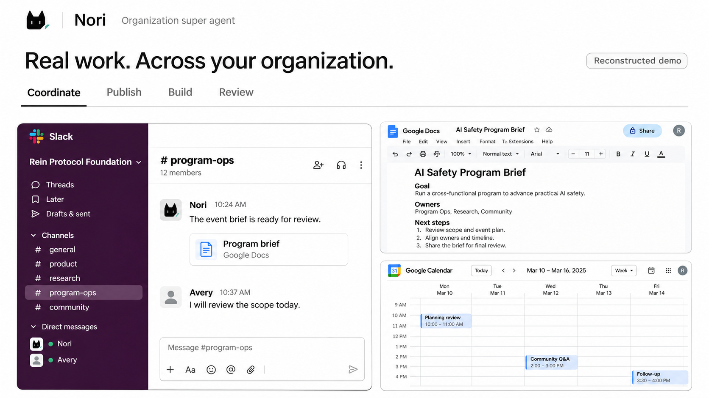
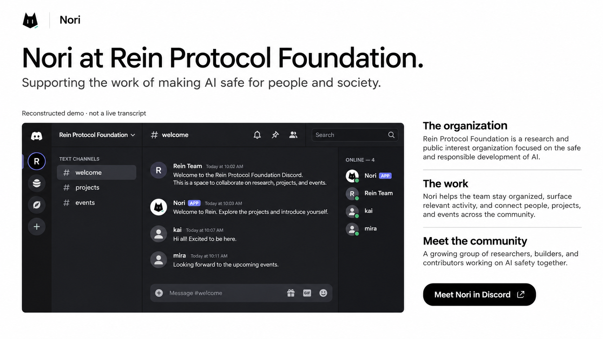
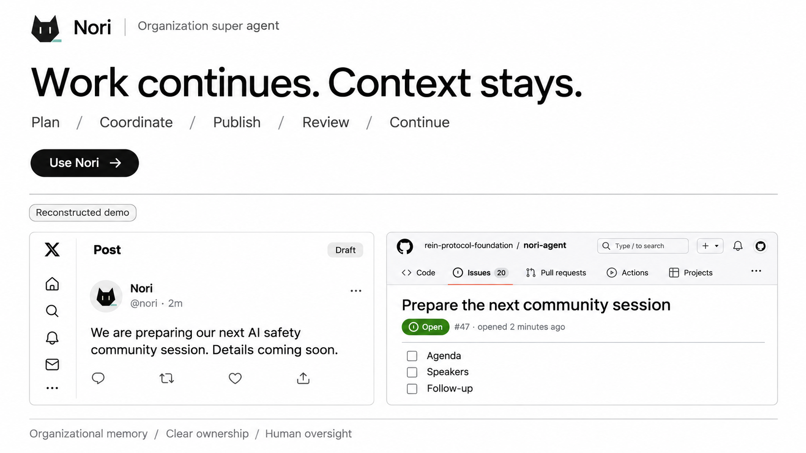
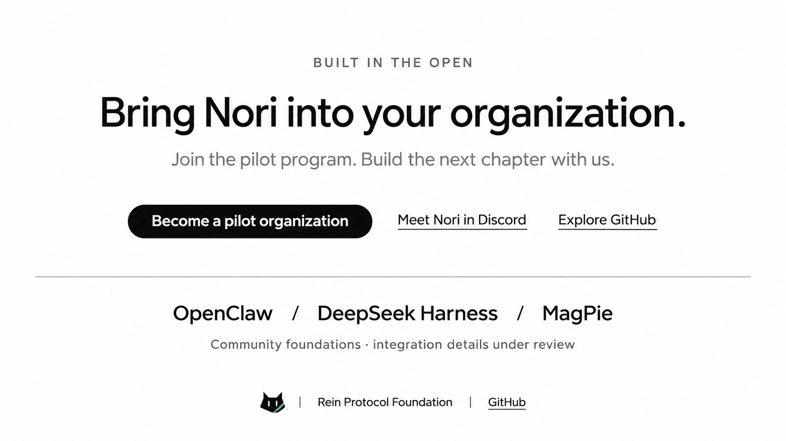
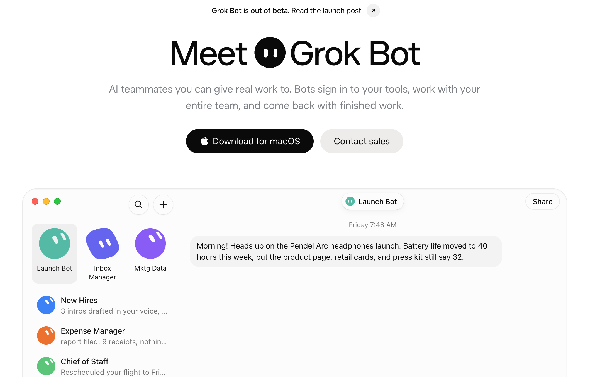
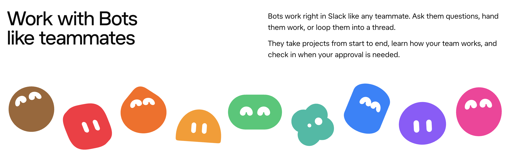
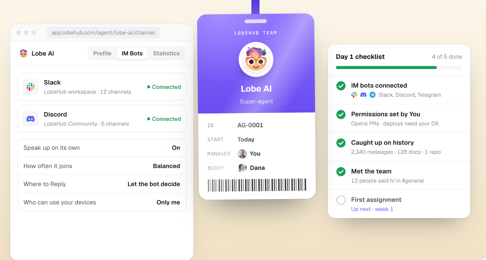

# Nori Website — Design PRD v0.2

> 历史视觉稿：用户认可黑白方向，但要求恢复 Nori 身份、改善界面比例、增加跨平台案例与 Z 轴层次。当前规范见 [v0.3](design-prd-v0.3.md)。本版的黑猫标识、Reconstructed demo 标签和技术项目列表不再采用。

日期：2026-11-11 · Task：WEBSITE-DESIGN-02 · Owner：Codex / Rein Protocol Foundation

状态：第二轮视觉评审稿，尚未获得用户认可。六张新版视觉稿已生成；未开发、推送、部署或替换产品正式头像。v0.1 保留作对照。本版取代 v0.1 的色彩、角色画风、区段构图和软件呈现规则；原有业务范围、证据分级和体验/试点目标继续保留。

## 1. 本次调整

用户反馈：角色过于可爱，颜色过淡，第三段偏日系软萌；Slack 和 Discord 与真实软件差异明显，其他软件展示不足。工牌结构获得认可。

| 维度 | v0.2 决策 |
| --- | --- |
| 品牌观感 | 黑白、高对比、克制的企业产品网站；参考 Grok Bot 的信息层级 |
| 角色 | 从幼态插画探索为简洁、角度明确的猫耳 agent 标识；不再使用腮红、粉发、大头身体或卖萌动作 |
| 角色占比 | 产品展示只保留小头像；大形象集中在工牌区 |
| 工牌 | 保留透明卡套、挂绳、金属扣与职责排版，换黑白底与小面积角色色 |
| 软件 | 独立保留原软件色彩和布局，不将全部界面染成品牌色 |
| 新增触点 | Google Docs、Google Calendar、X、GitHub，与 Slack、Discord 一起呈现工作链 |
| 产品定位 | organization super agent；nonprofit/NGO 优先；Rein 为主案例 |

新猫耳标识是本轮探索，不是已批准的品牌换标。保留原始 Nori 资产，后续可以在简洁符号与更成熟角色之间进一步校准；本轮未改动 agent 仓库。

## 2. 视觉与交互规格

- 基础色：背景 `#FFFFFF`，正文 `#0A0A0A`，辅助文字 `#737373`，边线 `#E5E5E5`，浅面板 `#F7F7F7`。去除全屏薄荷色、奶油色和粉色。
- 品牌强调色只用于小标识或配饰：深青 `#24524F`；Creative 可少量使用钴蓝。软件自身颜色不受这一限制。
- 字体：Inter / 系统 sans-serif；H1 72/80px、字重 500，H2 48/56px、字重 500；正文 18/28px。移动端 H1 40/46px、H2 30/38px、正文 16/25px。避免此前大面积粗黑字与手绘下划线。
- 1440px 桌面基准，最大内容宽 1280px、左右 48px；390px 移动端左右 20px。正文区域保持 60–75 字符行长。
- 按钮以黑色实心主按钮、灰色次按钮和文字链接构成层级；最小高度 48px。不添加 Try Nori / Use Nori 等暗示即时自助安装的入口。
- 软件面板圆角 10–12px，薄边框、无彩色光晕。工牌保留更强材质感，软件展示不使用悬空玩具场景。
- 工作流 tabs：Coordinate / Publish / Build / Review；点击和键盘可切换，默认 Coordinate，无自动轮播。内容状态固定标记为 Reconstructed demo，直到替换为实际证据。
- 移动端不缩放整张桌面图：将相关软件截图依序展开，保留关键消息与完整标签；工牌 2×2，案例单列，导航可折叠。
- 减少动态模式禁用位移和工牌倾斜；键盘焦点可见，按钮不靠颜色单独表达状态；正文对比度至少 4.5:1。

## 3. 六张新版区段稿

### 01 · Hero

黑白居中标题，下方工作界面条包含 Slack、Discord、X。主入口 Meet Nori in Discord，次入口 Explore GitHub，导航提供机构试点入口。

正式文案保留原先更准确的表述：

> An organization has a mission.
> Nori helps carry it forward.
>
> An open-source super agent for long-term operations and growth, built for nonprofits and NGOs.

图中较强的 “Nori carries it forward” 属视觉文案变体；正式实现以以上文本为准。开源表述仍需在发布前与许可证一致。已通过图像编辑去除 X 的虚构认证和互动数字。

### 02 · One Nori. Many responsibilities.

保留用户认可的实体工牌结构，改变画风与配色。四个角色用轮廓、配饰和职责名识别：Operations / Community / Finance / Creative。帽子、眼镜、耳机是小提示，不发展为卡通装扮。角色职责不变：内部协作、社群运营、财务工作流、内容营销。

底部渠道名称表示可讨论的工作触点，不是已连接状态。正式渠道关系图为角色与工具多对多，Finance 不因出现在同一张图而拥有其他角色的数据或执行权限。已移除生成器擅自添加的 Try Nori 和演示按钮。

### 03 · Real work. Across your organization.

主画面以 Slack 为任务入口，Google Docs 为工作产物，Google Calendar 为安排与后续工作。工作对象是同一个 AI safety program，避免无关系的软件拼贴。

- Coordinate：讨论目标、负责人、文档和会议安排。
- Publish：X 活动草稿、TikTok 视频预览与排期；目前 X 视觉见第五段，视频素材待细化。
- Build：GitHub issue 与后续交付；不虚构成功合并或部署。
- Review：总结、财务材料、下一轮待办与 handoff。

**状态：构图与信息层级稿。** 图中的 Slack 仍是重建，缺少与实际版本完全一致的导航层级；Docs 工具栏也有生成文字误差。Calendar 日期为示例，不是 Foundation 活动日程。不能将此图宣称为原版软件截图。

### 04 · Nori at Rein Protocol Foundation

白色网站背景配 Discord 原生风格的深色面板。保留服务器栏、频道栏、消息区和成员列表结构；去掉角色大插画与气泡式聊天。右侧介绍组织背景、工作与社区入口。

正式组织文案：Rein Protocol Foundation is a nonprofit focused on AI safety and making AI agents safe for people and society. 不采用生成图自行补充的 “research organization” 或 “growing” 等未经核实描述。

所有人物、时间与对话都是演示。固定显示 Reconstructed demo · not a live transcript。Discord 画面层级比旧版改善，但仍必须用真实截图核对图标、间距、成员栏与版本。

### 05 · Work continues. Context stays.

以 X 活动内容与 GitHub 后续事项展示长周期：Plan / Coordinate / Publish / Review / Continue。底部强调 Organizational memory / Clear ownership / Human oversight。

**下一轮素材修正要求：** 图中 X 把 Draft 和已发布帖子结构混用了，正式演示需要改为真实草稿编辑器或真实发布记录，不能保留这种混合界面。生成的 @nori、issue #47 和计数均是占位，不代表真实账号或仓库记录；应用真实素材时移除或替换。删除生成器额外添加的 Use Nori 按钮，统一使用既定 CTA。正式页面不重复每段左上角的 Nori 标识，生成图中的重复标识只服务独立稿预览。

财务与社媒能力仍在内容范围内：BNB Chain / Ethereum / Solana、银行和支付、审计、支出、筹款、融资、税务材料，以及 TikTok/Twitch。它们不会因为新版减少 logo 而从产品方向删除。发布时按实际状态单独标注；Stripe Atlas 单列为企业设立服务，不归为银行。此轮没有为每个业务系统制作独立界面图。

### 06 · Bring Nori into your organization

以试点入口收束。Meet Nori in Discord 与 Explore GitHub 保持次级。OpenClaw / DeepSeek Harness / MagPie 作为社区技术基础的文字致谢，名称、链接与实际集成关系仍需核对。

图中 “integration details under review” 是设计评审占位；正式官网完成核对后替换为准确的技术归属句，不向访客展示内部审核工作流。

## 4. 软件真实性：最终素材规则

这轮改善的是视觉方向、结构与软件覆盖，**未完成像素级原生界面验收**。纯生成不能可靠复现不断变化的软件 UI。后续正式案例采用：真实软件截图或录屏 → 脱敏 → 选择关键区域 → 页面排版。图像生成用于角色、工牌、示意构图，不负责重新绘制真实软件 chrome。

建议用户提供以下素材，各 1–2 张即可开始；无需提供账号、凭证或访问权限：

| 素材 | 希望保留的内容 | 用途 |
| --- | --- | --- |
| Slack 桌面截图 | 导航、频道名区域、一次 Nori 协调或交付 | 校准真实布局和工作片段 |
| Discord 桌面截图 | 服务器栏、频道栏、Nori 对话 | 主案例的准确界面 |
| X 截图或公开链接 | 真实帖子，或真实草稿编辑器 | 避免重建出不存在的 UI |
| 可选 Docs / Calendar / GitHub | 与上述活动有关的脱敏产物 | 串起同一任务，证明连续性 |

推荐原尺寸 PNG、不要只截头像或消息气泡；提前遮盖成员身份、内部讨论、金额和私人频道。若只提供通用软件参考，可以做准确的界面演示，但仍不声称为真实运营记录。

## 5. 参考图与致谢

### 主要视觉方向：Grok Bot

取其黑白对比、字号层级、直接的工作展示与克制按钮，不复制其产品入口、品牌或角色。

取其角色族的一致识别方式。Nori 本轮探索更简洁的猫耳符号，不使用 Grok 的几何角色，也不继续放大幼态人物。

### 保留的结构参考：LobeHub 工牌

保留工牌、挂绳和职责信息的组织方式；渠道状态以真实能力为准。设计参考只在 PRD 致谢，README 不写参考品牌。

来源：[Grok Bot](https://x.ai/bot)、[LobeHub](https://lobehub.com/)，以及用户提供的三张截图。原参考素材仅作设计研究，不作为官网生产素材。旧 Nori 头像仍保存在 references/nori-original.png，未被新探索替换。

## 6. 交付与检查

- 六张新版横向 PNG 位于 concepts-v0.2/；保留旧版 concepts/。
- [完整生成及修改提示词](prompts-v0.2.md)。使用内置 image_gen；模型版本不可验证，不声称已确认 GPT Image 2。共六次初稿生成、两次定向编辑。
- 人工视觉检查：去掉软萌大角色及淡彩底；工牌结构保留；新增 Docs、Calendar、X、GitHub；首屏虚构认证/互动数字已移除。
- 已知未完成：原生 UI 精确还原、最终角色确认、每个 tab 的独立素材、移动端高保真稿、真实案例证据。本文记录了需要修正的生成内容，不能直接当生产截图上线。
- 检查范围：本地图片数量/尺寸、文档图片引用、diff 空白检查。未进行网站构建、真实软件操作、浏览器交互或部署测试。
- 下一步：用户评审黑白方向与简洁猫耳形象；用提供的真实软件参考替换重建面板，再做细化。不在本轮启动网站开发。
