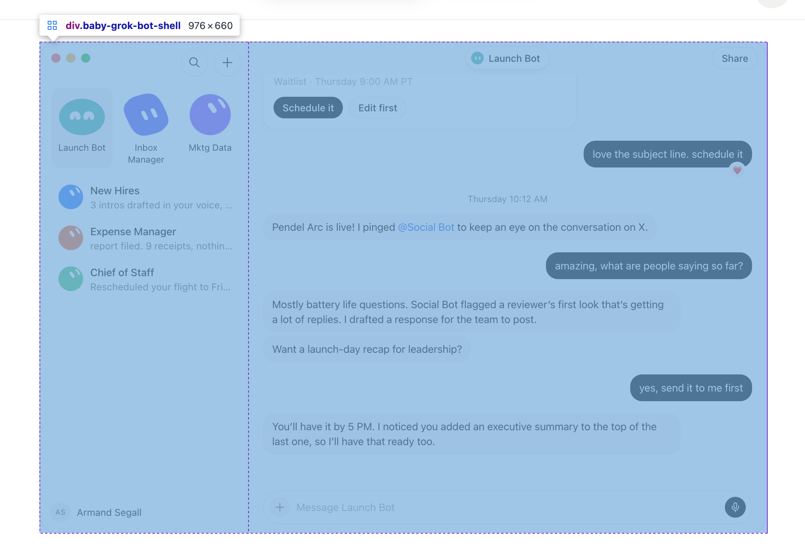
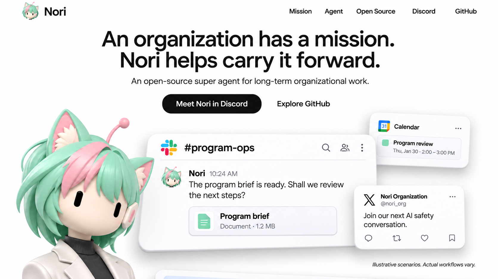
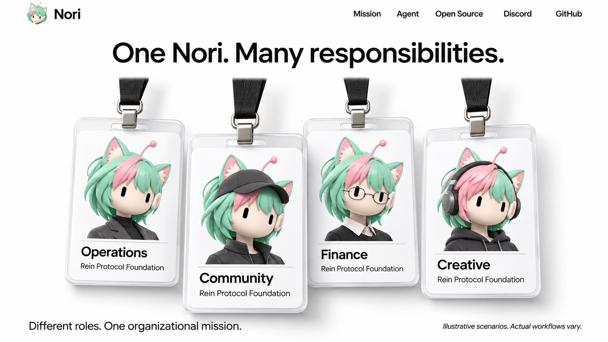
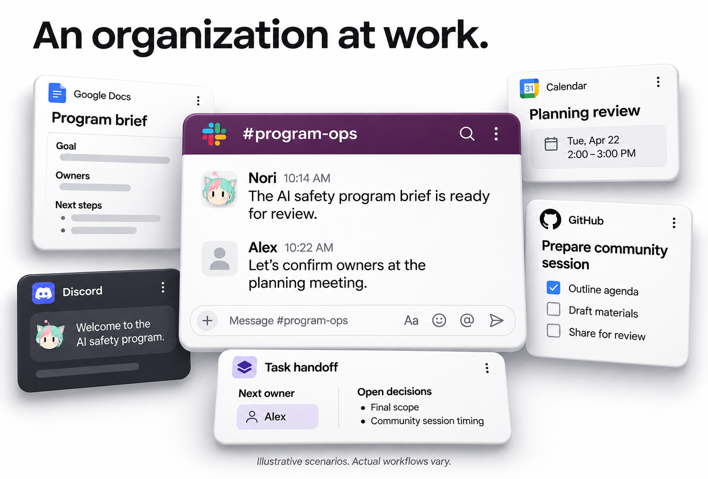
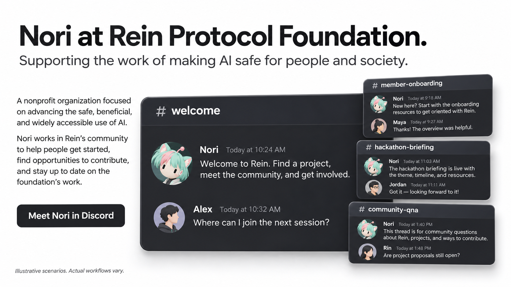
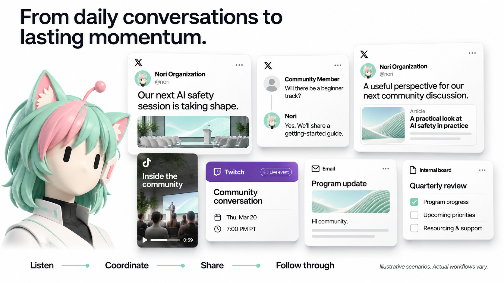
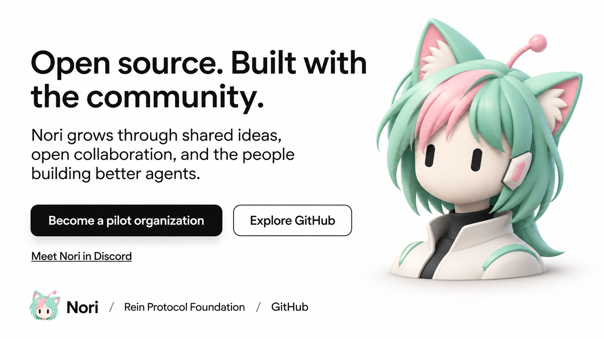
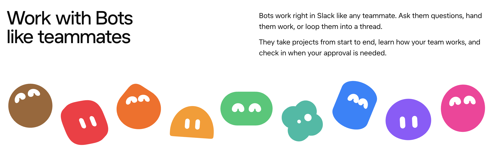
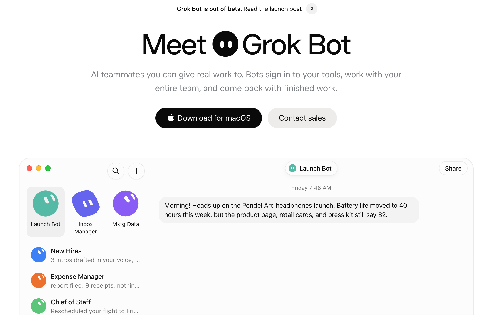
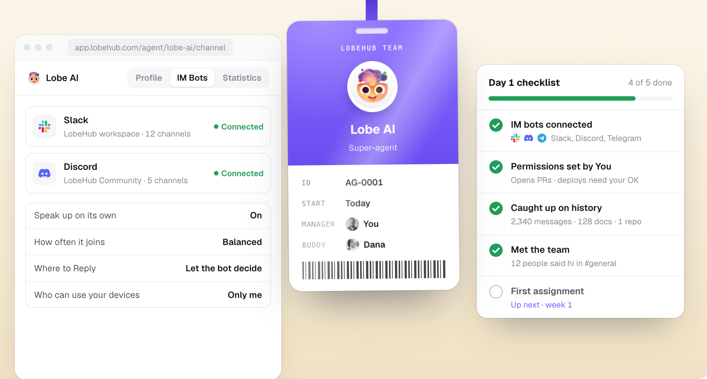

# Nori Website — Design PRD v0.3

> 历史视觉探索。当前内容与设计约束以 [网页内容设计 v0.4](website-content-v0.4.md) 为准：移除工牌外半身像及 Listen → Coordinate 装饰流程；工牌改为职位；金融基础设施与智能合约成为首页主章节。

日期：2026-11-11 · Task：WEBSITE-DESIGN-03 · Owner：Codex / Rein Protocol Foundation

状态：第三轮设计评审稿，未获最终批准。交付为六张区段概念图、场景清单、视觉与空间规格。本轮未开发网站、推送、部署或更改正式角色头像。

## 1. 设计决策

保留 v0.2 的黑白网站底色、高对比、工牌材质和企业产品气质。撤销全黑猫耳标识；恢复原始 Nori 的薄荷绿头发、粉色挑染、猫耳、耳机/天线和简洁黑色胶囊眼睛。眼睛参考用户偏好的 Grok Bot 式简洁表达，不复制其角色外轮廓。

新角色采用克制的 3D 半身形象：无腮红、无卖萌动作、无幼态身体；Operations 深色外套，Community 帽子，Finance 眼镜，Creative 耳机与更多粉色挑染。黑白 UI 与有色角色分层，不把网站背景重新染成粉薄荷色。当前角色仍是探索，独立头像与生产模型尚未交付。

产品展示从“多个缩小的完整 App”改为“一个主场景 + 多个局部产物”。以任务、对话、帖子、回复、文档和活动卡片为主，完整软件界面只在需要解释上下文时使用。

## 2. 产品图比例与 Z 轴

用户参考截图标注了产品壳 976×660，比例约 1.48:1。借鉴其充分的展示面积与自然内容比例，不复制截图里的开发者检查蓝色覆盖层或紫色边框。

### 比例规则

- 完整产品视图参考宽 976、高 660 CSS px，容器不足时等比例缩放，不分别拉伸宽高；这是展示参照，不强迫所有软件统一比例。
- 图片始终保留原始宽高比；局部卡片按内容裁取，不能把完整 desktop app 挤进 280px 宽的小卡片。
- 主聊天线程桌面展示宽 720–976px，截图正文目标 14–16px 可读尺寸；外围卡片通常宽 280–400px。尺寸不足时减少同时展示的数量，不继续缩小文字。
- X 帖子、reply、quote/repost 按内容自然高度；视频保持 9:16；会议卡、任务卡用自身内容高度。
- 1440px 基准页面最大内容宽 1280px。视觉场景可以溢出常规正文列，但不能造成页面横向滚动。

### 三层空间系统（后续实现规格，非本轮代码）

| 层 | Z 轴位置 | 使用对象 | 视觉表现 |
| --- | --- | --- | --- |
| 背景 | -64px | 文档、日历、背景任务 | 较弱阴影，主体保持清晰，不用模糊掩盖小字 |
| 主层 | 0px | 当前主线程或主案例 | 最大阅读面积，接近正视 |
| 前景 | +48px | 回复、产物、交接、活动卡 | 稍强阴影，仅遮挡其他卡的边缘 |

场景 perspective 1400px，transform-style preserve-3d。主画面 rotateX/Y 不超过 2°，辅助卡不超过 5°；禁止夸张等距视角与明显文字变形。遮挡不超过单张卡面积的约 15%，且绝不覆盖标题、关键消息或 CTA。阴影体现悬浮距离，卡片边缘保持薄而清楚，不做膨胀的玩具 UI。

若后续增加指针视差，范围最多 ±6px/±2°，不改变阅读顺序；键盘聚焦对应卡回到清晰前层。移动端及 reduced-motion 模式取消透视/位移，按语义顺序纵向显示。所有信息必须在没有 3D 动效时仍然可读。

## 3. 六个区段

### 01 · 首屏

主文案：An organization has a mission. Nori helps carry it forward.

副文案正式采用：An open-source super agent for long-term operations and growth, built for nonprofits and NGOs.

CTA：Meet Nori in Discord / Explore GitHub。导航保持 Capabilities / In action / Rein Foundation / Open source，并提供 Become a pilot organization。生成图的导航为占位，以本文为准。

一个主工作线程与日历、X 卡片构成入口，不再使用三列完整 App。图中 Nori 肖像用于判断恢复后的身份，后续版式若压缩主工作画面，优先缩小肖像而不是缩小软件文字。

### 02 · 分身工牌

保留透明卡套、黑色挂绳和金属扣，用前后错位体现角色团队。Operations / Community / Finance / Creative 的脸型、头发与眼睛同属 Nori 家族，以配饰体现职责。

生成图中的重复顶栏与场景脚注不进入实际工牌段落；完整页面只有一次主导航，角色展示也不需要工作流免责声明。角色职责沿用前版，不能凭工牌授予组织或财务权限。

### 03 · An organization at work

以 AI safety program 为同一任务：Slack 协调 → 文档 brief → 日历评审 → Discord 欢迎 → GitHub 待办 → 任务交接。六个工作产物具有清晰主次与 Z 层级。

该图用于空间构图，不是原软件像素规格：生成器仍把部分图标、文字与圆角放大了。最终素材应使用真实局部截图，保留软件自己的字号、图标和布局；仅对截图外部施加位置、阴影与轻微透视，不重新绘制软件 UI。

### 04 · Nori at Rein Protocol Foundation

主 welcome 线程 + onboarding、hackathon briefing、community Q&A 三个局部线程，表现一个组织内的连续实践。组织介绍采用已确认的 AI safety 与 nonprofit 定位，不使用生成器补充的广泛组织事实。演示人物、消息、时间不是已核验的运营记录。

最终主画面必须留足文字空间，右侧前景卡不得遮住 welcome 消息。当前构图仍有局部靠近/遮挡，细化时将右侧卡整体外移并放宽场景，不靠缩小主线程解决。

### 05 · 跨平台运营实践

场景按“组织工作”组织，不按软件 logo 数量组织：

| 业务 | 展示对象 | 要表达的行为 |
| --- | --- | --- |
| X 组织账号 | 原创活动帖卡片 | 发布组织动态、招募与活动信息 |
| X 社群互动 | 一条问题和 Nori reply | 回答参与问题，衔接到活动资源 |
| X 内容传播 | 转帖或引用卡片 | 分享相关讨论并补充组织观点；非名人背书 |
| TikTok | 9:16 视频局部预览 | 活动短片与内容传播 |
| Twitch | 直播活动安排 | 社区对话、分享与直播预告 |
| 资助人关系 | 邮件摘要卡 | 定期活动更新、跟进与筹款沟通 |
| 董事会与内部运营 | 季度议程卡 | 项目复盘、资源安排与后续责任 |

与第三、第四段一起覆盖 Slack、Discord、Docs、Calendar、GitHub、X、TikTok、Twitch、邮件和内部文档。已有/演示/规划状态仍需按真实证据核对，不代表所有平台都已部署。

后续可选案例：成员入职/离职 handoff、董事会投票、财务审计、募资计划、链上资金与银行工作流。它们保留在内容范围，不能为了增加画面数量伪造交易、支付、报税成功或实际融资结果。

生成图的 @nori 等账号文字是占位，发布前使用真实获准展示的账号或清晰示例身份；虚构活动现场图不当作 Foundation 实拍。Nori 的大型肖像不应挤占七个案例的阅读面积，最终可移到场景外侧或移除。

### 06 · 开源与参与

正式文案：

> Open source. Built with the community.
>
> Nori grows through shared ideas, open collaboration, and the people building better agents.

CTA：Become a pilot organization / Explore GitHub / Meet Nori in Discord。

官网不展示 OpenClaw、DeepSeek Harness、MagPie 的并列列表、logo 或技术背书，也不出现 integration details under review。它们的依赖层级与工程归属留在技术文档中，不混入本段产品叙事。开源许可证仍需在发布前确认。

## 4. 关于演示标注

删除官网里的 **Reconstructed demo** 标题、徽章、按钮和逐卡标签。它是素材制作状态，不是用户价值。

对尚无真实证据的合成案例，整组案例下保留一句普通小字 **Illustrative scenarios. Actual workflows vary.**，不与主 CTA 争夺注意力，不做成按钮。可另提供简短场景说明。生成的各段图片带有重复脚注，是为了独立审阅；最终连续案例组只需清晰的一处说明。真实记录替换后改为日期与来源。

不隐瞒合成性质，也不把内部制作术语变成产品功能。所有“已运行”主张需要实际证据，真实消息截图须脱敏。图片生成负责空间探索和角色，真实软件界面素材负责准确性。

## 5. 参考与致谢

新参考图见第二节；检查器的尺寸信息仅用于比例研究。其余三张用户参考继续保留并直接嵌入本版：

借鉴简洁眼睛与角色家族识别，不照搬其外形。

借鉴标题、留白、主产品画面的面积；入口改为 Discord 与试点。

仅借鉴用户认可的工牌与职责表达，不使用其角色设计。

来源：[Grok Bot](https://x.ai/bot)、[LobeHub](https://lobehub.com/)，用户提供截图。仅作设计研究，官网不使用这些参考截图或参考品牌致谢。Nori 原始身份参考为 references/nori-original.png。

## 6. 本轮验收与交接

- 六张独立横向图片存于 concepts-v0.3/；v0.1 和 v0.2 保留作对照。
- [完整提示词](prompts-v0.3.md)。六次内置 image_gen 调用，底层模型版本未提供，不能确认是 GPT Image 2。
- 已检查：发色/猫耳/胶囊眼睛恢复，黑白网站方向保留，多平台局部案例增加，静态前后层次可见，开源区项目名单移除；文件、图片比例与文档引用可验证。
- 未完成：真实软件像素级校准、独立头像生产素材、响应式高保真稿、真实 3D 交互、真实案例证据。静态图片只有 Z 轴视觉效果，不是可操作的 3D 页面。
- 下一步先评审本版的角色与空间关系。若要精确展示原生 Slack/Discord/X，请提供脱敏原尺寸截图；届时裁取局部，以等比例贴图方式排版，不再由生成器重画 chrome。
- 代码、构建、网站测试、推送、Vercel 与 DNS 操作均未执行。
