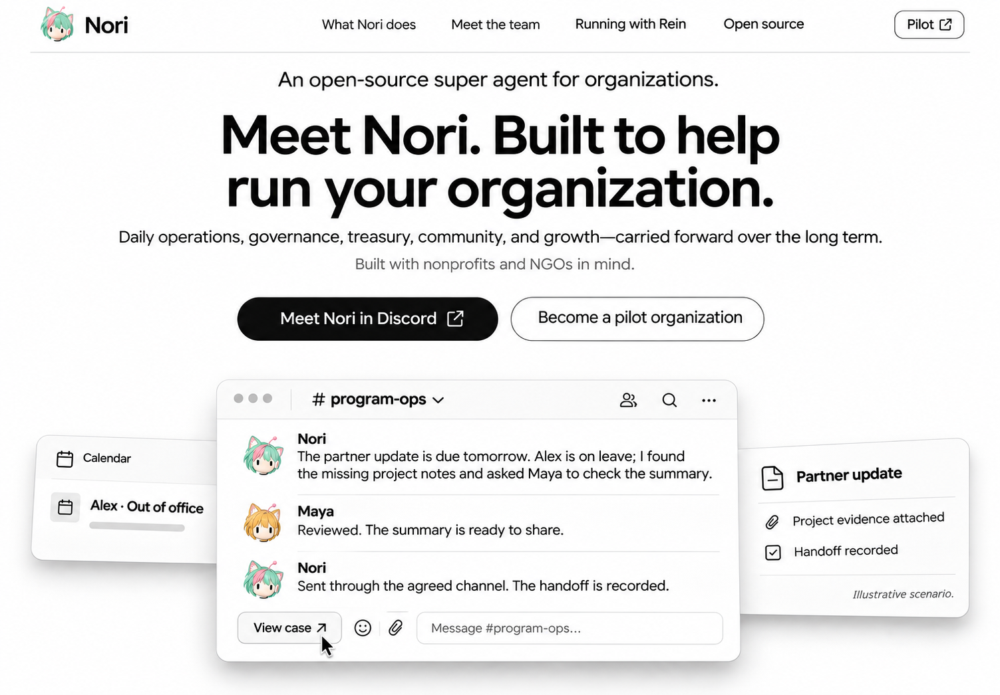
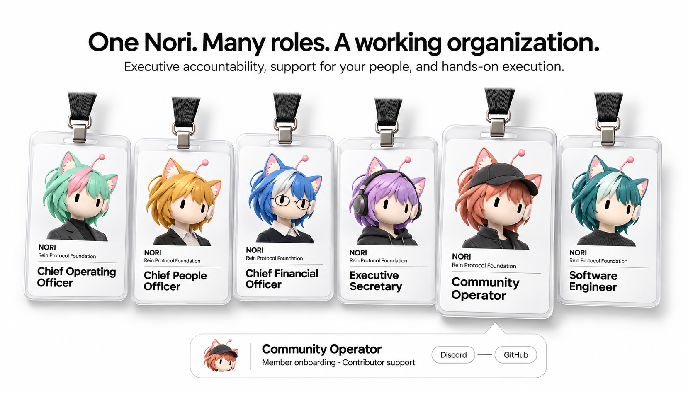
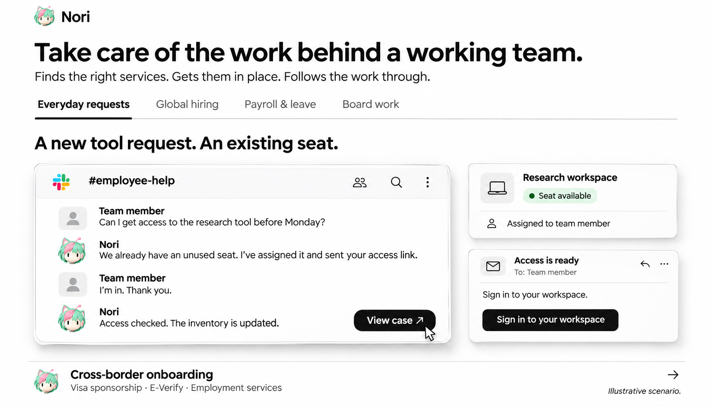
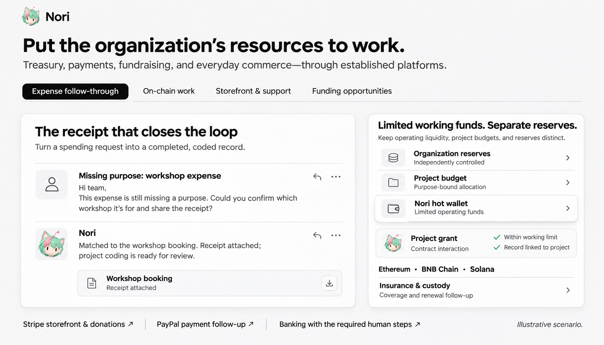
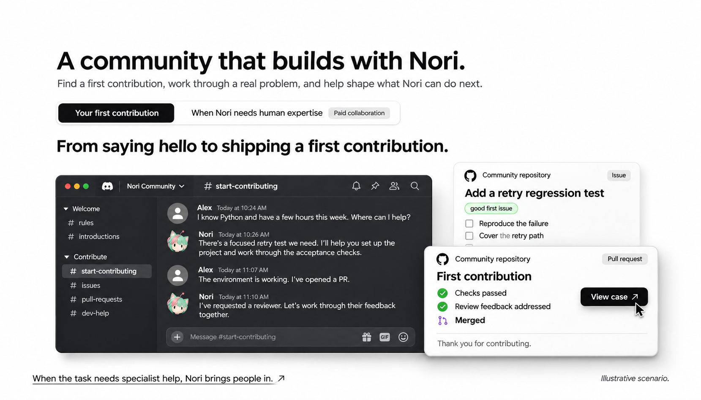
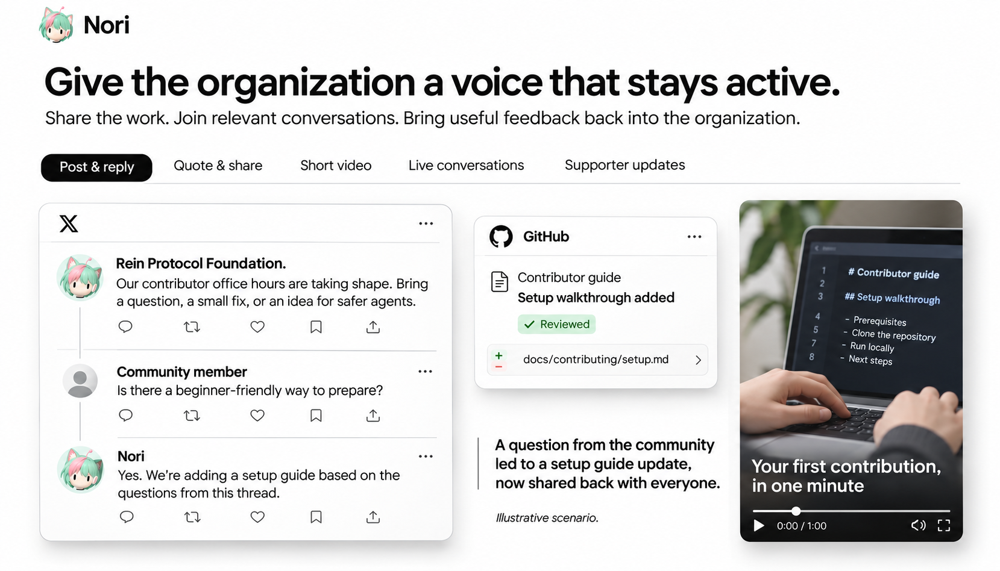
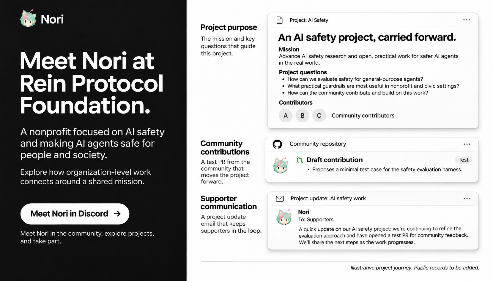
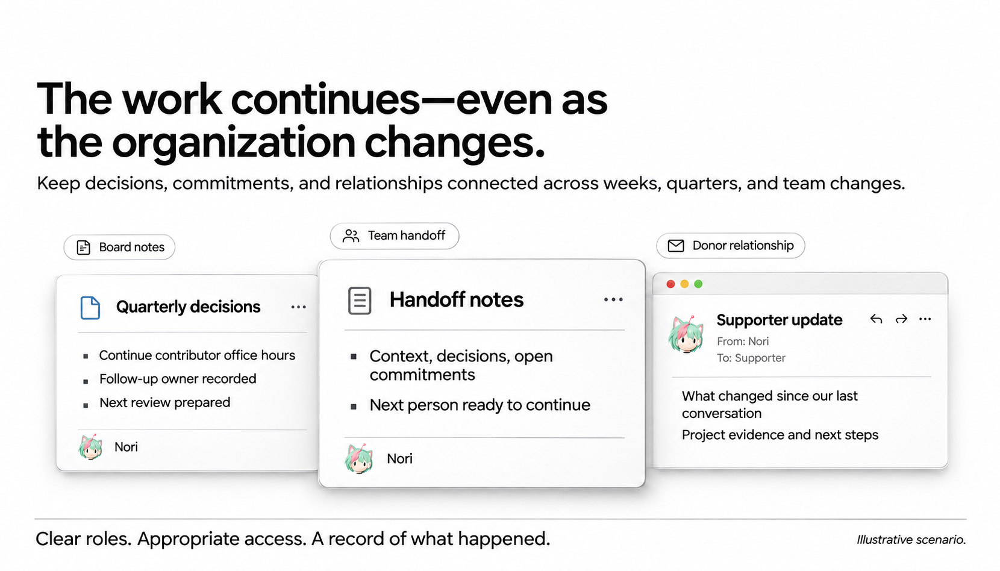
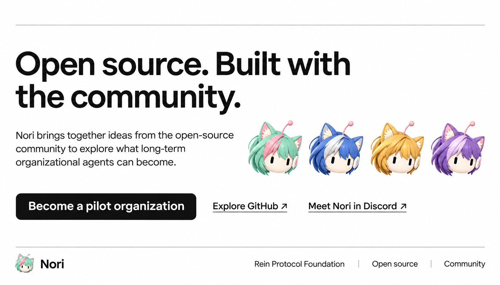
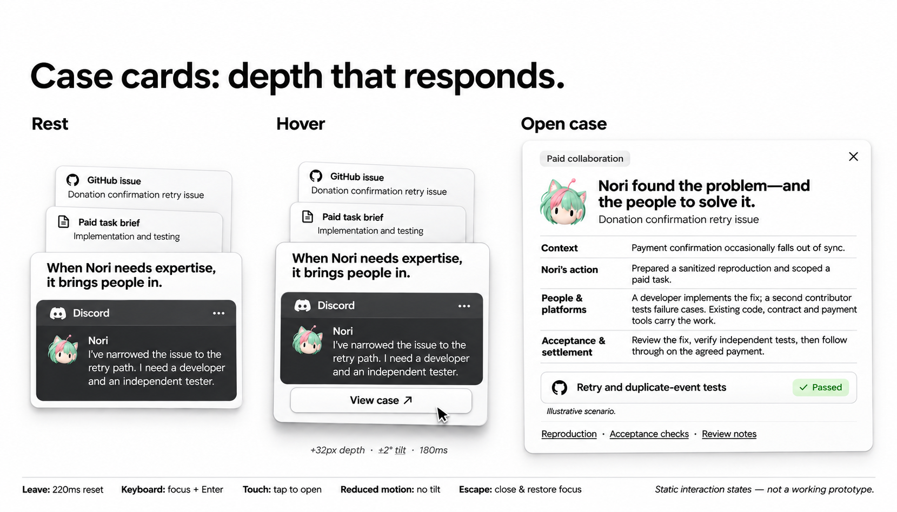

# Nori Website UI 设计图 v0.4

日期：2026-11-12
任务：WEBSITE-DESIGN-04 · Owner：Codex / Rein Protocol Foundation
依据：[website content v0.4](website-content-v0.4.md)，WEBSITE-CONTENT-07。
状态：用户于 2026-11-12 认可本版 UI 设计，并授权将本地设计与内容文档提交及创建 PR。包含 9 个网页章节设计图＋1 张交互状态附图；仅图像与设计文档，未开发网页、连接账号或部署。

## 本版方向

黑白高对比、工作产物为主、角色色彩为辅。保留用户认可的实体工牌结构与 Nori 的猫耳、发型轮廓、胶囊眼睛、天线/耳机；原始薄荷粉身份保留，其他角色大胆换发色。半身照仅出现在工牌中。

案例先用高频、能直接看懂的组织工作建立价值，再深入 HR、金融与人类专业协作。每段使用主故事与少量产物；其余案例通过选择与展开承接，不把内容池平铺成平台清单。社区从活动叙事扩展为贡献者成长和付费协作。

历史正向参考与保留范围见[内容稿第 5 节](website-content-v0.4.md#5-正向参考与视觉约束)。原 v0.3 第 5/6 图仍为负向构图参考；本版没有巨大半身像陪衬案例，也没有 Listen → Coordinate 装饰流程条。

## 图集

### 01 · 首屏 · 工作不因负责人离线而停下

高频承诺跟进入口：负责人离线，Nori 发现缺口、协调接续并留下交付记录。主工作线程在前，休假与交付物分列后层。首屏英文 supporting copy 为适配画幅作了压缩，完整文案以内容稿为准。

### 02 · 工牌 · 从高管到一线

保留透明卡套、黑挂绳、金属扣和工牌内半身照；六个具体职位覆盖高管、员工服务和一线执行。发色分别为薄荷粉、金、蓝银、紫、铜红、深青。角色关系预览连接 Community Operator 与 Discord / GitHub。

### 03 · 内部运营 · 先调用已有资源

默认选中 Everyday requests：发现已有席位并完成开通，表现判断与持续推进。Global hiring、Payroll & leave、Board work 作为其他场景入口；跨国入职保留可展开入口。

### 04 · 财务 · 日常资金与受限链上执行

支出凭证核对是日常入口；右侧保留储备、项目预算与有限热钱包的独立层次，以及智能合约执行、Ethereum / BNB Chain / Solana 和保险续期。支付、店铺、银行和筹资是同节其他场景，不做集成商标墙。

### 05 · 社区 · 新人到开源贡献者

默认展示新人从 Discord 打招呼到 issue、PR、评审与首次贡献。第二故事入口为 Nori 寻求人类专业帮助与付费协作，展开状态见图 10。已移除初稿生成器添加的错误仓库名称。

### 06 · 传播 · 反馈形成下一次行动

选取公开帖子与 reply、贡献指南修订、竖版视频三个产物，说明反馈如何转成组织行动。Quote、直播与支持者更新保留为同节可选故事。视频画面是生成的 storyboard，不是实际活动录像。

### 07 · Rein · 组织级主案例

以黑白分区改变页面节奏，汇合使命、社区贡献与支持者更新。项目工件为演示叙事；已删除生成器虚构的仓库地址、PR 编号和邮件地址，不作为真实运行证据。

### 08 · 连续性 · 下一位成员能够接着做

用季度决策、交接摘要、支持者更新表达工作如何跨人和跨周期延续。移除重复导航，不添加装饰性流程箭头。

### 09 · 开源与参与 · 清晰收束

用头部变体收束品牌识别，提供机构试点、GitHub、Discord 三个参与入口。没有软件名单、安装命令或 App 下载入口。

### 10 · 交互状态 · Nori 向人类寻求专业帮助

设计评审附图，不是首页第十章节。对比常态、悬停与案例详情；用 Nori 发现捐赠确认问题后组织开发和独立测试的故事展示求助、付费任务、验收、结算。图上状态为视觉示意，不代表交互已实现。

## Z 轴交互交接

- 常态：稳定浅层次，标题与主要信息始终可读，不自动漂浮。
- 悬停：在固定外层命中区域内 translateZ 约 32px、180ms ease-out；正文卡倾斜不超过 ±2°，其他卡不超过 ±3°，perspective 约 1400px。
- 离开：220ms 恢复，无弹跳；View case 在预留空间显示，不能增大卡片排版高度或推动相邻卡。
- 点击：桌面打开约 640px、最多 90vw 的案例详情；窄屏全屏详情。Esc/关闭后恢复触发卡焦点与原滚动位置。
- 键盘：可见焦点，Enter/Space 展开；触摸直接单击展开。
- 减少动态：取消位移与倾斜，保留焦点、阴影与全部内容。

图 10 是状态意图示意，生成图中两态边界并非像素级几何测量。后续实现须以以上固定尺寸与命中区域规则为准，不能照图引入 hover 改变布局占位的行为。

## 图像边界与下一轮素材

本版用于评审信息层级、案例编排、角色与卡片空间效果。Slack、Discord、GitHub、X 和财务片段仍是生成式场景示意，未声称逐像素还原原版 UI，也未作为真实运行记录。进入最终视觉精修时，以获授权、脱敏的原生界面截图替换：Slack 请求线程、Discord 贡献/求助线程、GitHub issue/PR、X 原创/reply/quote，以及支付/钱包局部。无需提供账号或凭证。

正文图中的界面按钮只是图片内容；网站实际点击目标应统一为案例入口，不让截图里的登录、发送或支付控件成为真实动作。详细英文文案、场景范围与真实性状态仍以内容稿为准。

各图中独立出现的小 Nori 字标用于单张评审识别；整页拼接时导航只在首屏保留，不逐节重复。内页 CTA、tab、圆角与字体在后续定稿统一，当前没有实现可交互原型。

## 生成与核对记录

使用内置 image_gen，参考现有工牌图与原始 Nori 头像，逐节独立生成。基础提示词完整保存于 [prompts-v0.4.json](prompts-v0.4.json)，定向修订提示词保存于 [refinements-v0.4.json](refinements-v0.4.json)。工具未暴露模型选择参数，因此不额外宣称某个具体模型版本。

人工目视核对：9 节＋状态图齐全；原始 Nori 身份和大胆发色；六个具体工牌职位，无 Manager；案例区没有巨大半身像；新贡献者与人类付费协作均有呈现；金融与链上部分保留；错误仓库/邮件标识已清理。图片读取、横向比例、文档图片引用与 JSON 格式另做本地检查。

未进行网页构建、运行交互或真实平台集成测试，因为本轮没有网页实现。用户已认可本版视觉方向；后续反馈在本版基础上调整。该认可不代表演示案例已成为真实运行记录。

设计参考致谢仅保留在设计文档：[Grok Bot](https://x.ai/bot) 的视觉层级与产品展示，[LobeHub](https://lobehub.com/) 的工牌思路。未修改 README 的设计参考。
