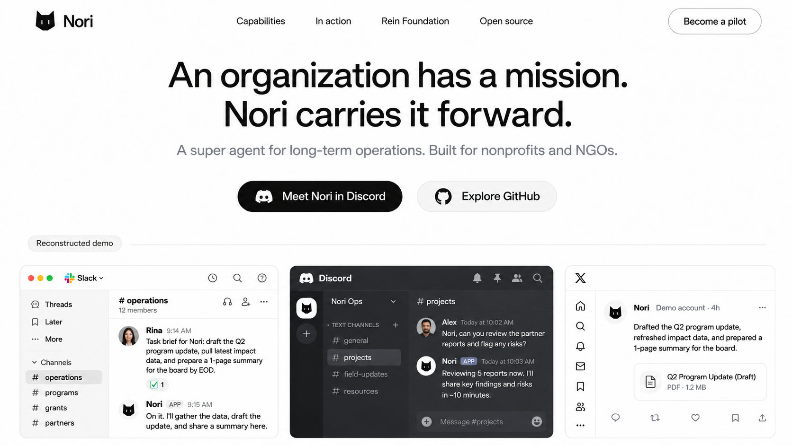
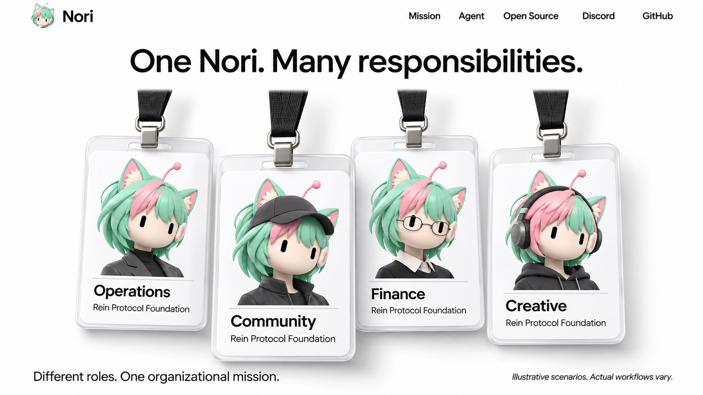
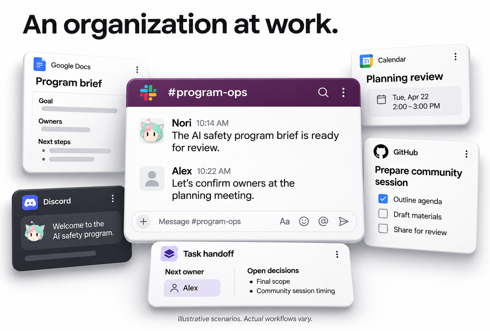
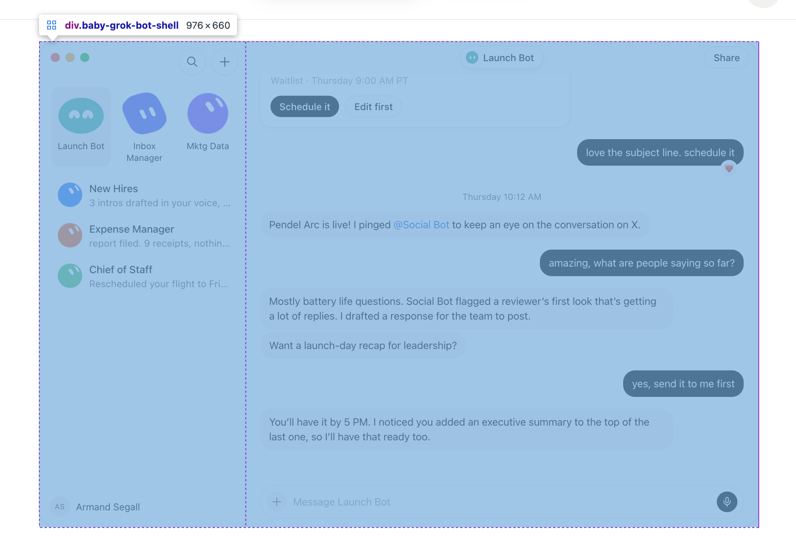
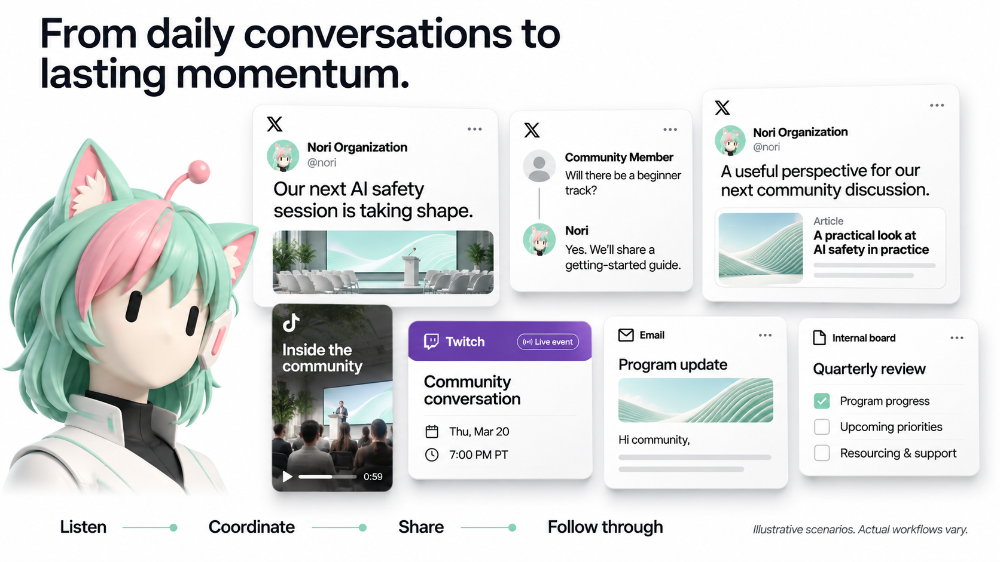
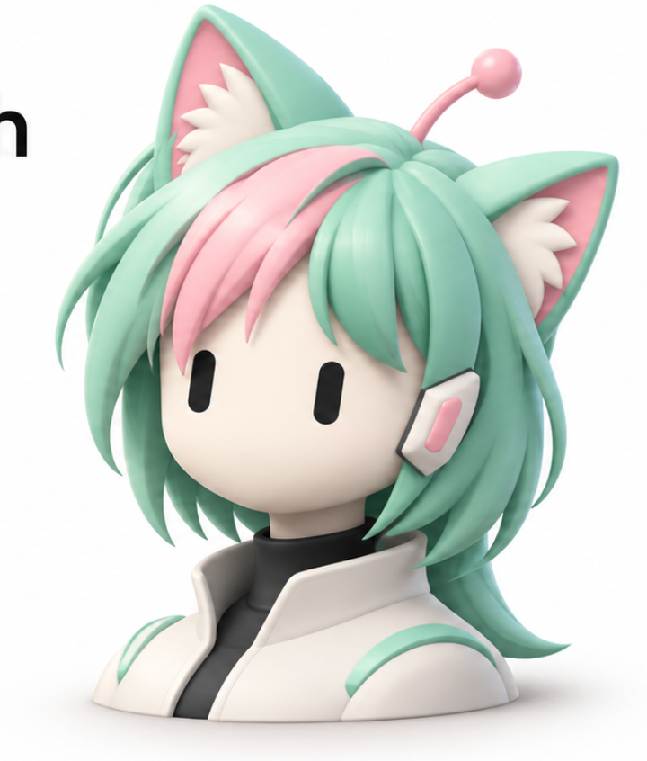

# Nori Website — 网页内容设计 v0.4

日期：2026-11-12 · 最新修订：WEBSITE-CONTENT-07 · Owner：Codex / Rein Protocol Foundation

状态：文本内容与叙事评审稿。本轮在当前文档内修订，不生成新图、不开发网站。历史设计中获得正向反馈的部分已直接嵌入第 5 节，并注明保留范围。以下英文为拟议官网文案，中文为内容策略与设计说明。

本次重点：按工作频率、组织痛点和 Aha Moment 重新选择案例；补充主动发现与推进工作的原创场景；展开新人到开源贡献者、Nori 向人求助与付费协作的故事；明确 Z 轴卡片的指针、键盘和触摸交互。此前确认的角色、HR、金融、参考图和视觉约束继续有效。

后续状态（2026-11-12）：已依据本文生成并获得用户认可的 [UI 设计 v0.4](ui-design-v0.4.md)。本文保留内容策划依据与场景边界；未开始网页开发。

## 1. 核心定位：长期经营一个组织

**Nori 是一个能够持续承担组织职责的开源 super agent。** 它围绕组织使命，协调人员、项目、治理、资金、社区与对外关系，在已有工具和组织制度中工作。首要受众是 nonprofit / NGO 的创办者、负责人、运营团队和董事会成员；开发者与贡献者是第二入口。

首页要让访客形成三个判断：Nori 理解组织的长期工作；它能够跨职责推进事情并留下可接续的成果；可以进入 Rein Protocol Foundation 的社区亲自认识它。

“Super agent”的内容依据：

- **承担职责**：接住持续存在的工作，例如成员协调、预算跟踪、社群维护，而不只是回答一次问题。
- **主动推进**：发现待办、准备材料、追踪承诺、识别需要人决策的事项。
- **跨角色完成工作**：让一次倡议走过预算、治理、筹资、招募、执行、传播和复盘。
- **调动成熟服务**：独立推进方案选型、采购、接入、执行和后续跟进，借助现有基础设施完成任务，而不止于推荐一份工具列表。
- **保持组织连续性**：成员更替后，决策背景、关系、未完成事项与下一步仍然可用，并遵守数据访问边界。

这五点是文案的判断标准，不做成空泛口号卡。网页通过具体场景表现它们。Nori 的能力来自对任务的理解、跨系统执行和持续推进；雇佣、薪酬、签证、支付和保险等专业环节通过成熟平台与服务商完成。

## 2. 全页阅读顺序

导航建议：What Nori does / Meet the team / Running with Rein / Open source；右侧 Become a pilot organization。

| 顺序 | 章节 | 访客需要理解的内容 | 内容比重 |
| --- | --- | --- | --- |
| 01 | 首屏 | Nori 是谁，为什么与组织有关 | 大开场，短文案 |
| 02 | 角色与职责 | 一个 Nori 如何以多个分身承担具体职位 | 工牌，适度展开 |
| 03 | 运营与治理 | 日常任务如何连到人员、董事会和季度目标 | 主要案例章节 |
| 04 | 资金与金融基础设施 | 组织如何连接链上与传统资金、支出与筹资 | 主要案例章节，与运营同等权重 |
| 05 | 社区与项目 | 如何从成员加入走到活动和长期参与 | 主要案例章节 |
| 06 | 传播与关系增长 | 如何持续获得关注、互动与支持 | 主要案例章节 |
| 07 | Rein 主案例 | 以上工作如何共同服务一个真实组织 | 跨章节汇合的重点 |
| 08 | 长期连续性 | 工作如何跨周、跨季度和跨人员延续 | 简洁但具体 |
| 09 | 开源与参与 | 如何体验、合作或贡献 | 收束与转化 |

不把每个章节都做成满屏。03–06 是不同叙事节奏的案例段落，不是四组相同的平台网格。首页先精选代表性场景，更多场景在同段展开或下一阶段独立内容页承接；不把全部细节挤进首屏。

## 3. 逐段英文文案与内容设计

### 01 · 首屏：明确说出组织级定位

**Eyebrow**

An open-source super agent for organizations.

**Headline**

Meet Nori. Built to help run your organization.

**Supporting copy**

From daily operations and governance to treasury, community, and growth, Nori carries work forward over the long term—alongside your team, in the tools you already use.

**Audience line**

Built with nonprofits and NGOs in mind.

**CTA**：Meet Nori in Discord（主） / Become a pilot organization（次）；GitHub 用导航或轻量文字链接。

原先 “An organization has a mission. Nori helps carry it forward.” 保留为 Rein 案例或品牌宣言，不再占用首屏唯一解释产品的机会。

**展示对象**：首屏主案例固定为“有人休假，一项对外承诺仍能按时推进”：Nori 从未完成事项中发现临近截止的承诺，找到缺失材料，联系可接续的人或适用服务，完成交付并留下记录。主画面是短工作线程，辅助卡是交付物和状态变化。它以高频、容易理解的工作进入，再揭示跨人、跨工具的主动推进能力。首屏不列出所有平台；Nori 仅用头部头像。该场景以产品演示呈现。

### 02 · 角色：从高管到一线执行的 Agent Org

**Headline**

One Nori. Many roles. A working organization.

**Supporting copy**

Executive accountability, support for your people, and hands-on execution—different Nori roles work together to move the organization forward.

**职位逻辑**：高管对组织运营、人力和财务等领域的结果负责，并向人类成员、董事会及适用的股东、潜在投资人和社区汇报；员工服务岗位帮助人类员工解决日常事务；一线岗位直接交付工作。分身协作不复制层层管理员工的 Manager 职位。

首组工牌建议六张，覆盖三类职责。其他职位在角色浏览与对应案例中展开；工牌职位不能再用 Operations / Community / Finance / Creative 分类名。

| 展示 | 职责类型 | 工牌职位 | 职责摘要（英文） | 形象方向 |
| --- | --- | --- | --- | --- |
| 首组 | 高管 | Chief Operating Officer | Keep the organization moving and report progress, priorities, and outcomes. | 原始薄荷绿＋粉色挑染，深色外套 |
| 首组 | 高管 | Chief People Officer | Connect workforce needs and employee experience to organizational decisions. | 暖金/琥珀色主发色 |
| 首组 | 高管 | Chief Financial Officer | Report financial position, commitments, and the resources behind the mission. | 钴蓝/银蓝主发色，眼镜 |
| 首组 | 员工服务 | Executive Secretary | Take care of scheduling, documents, travel, and follow-through. | 紫罗兰主发色，简洁耳机 |
| 首组 | 一线执行 | Community Operator | Welcome members, answer questions, and help people participate. | 珊瑚橙/铜红主发色，深色帽子 |
| 首组 | 一线执行 | Software Engineer | Build, test, and deliver the software work the organization needs. | 深青/墨绿主发色 |
| 扩展 | 员工服务 | HR Specialist | Coordinate onboarding, employment services, leave, and employee requests. | 银白/紫色挑染 |
| 扩展 | 员工服务 | Payroll Specialist | Keep payroll inputs, provider follow-up, and employee pay queries moving. | 石墨灰/电蓝挑染 |
| 扩展 | 一线执行 | Event Producer | Organize speakers, participants, logistics, and event delivery. | 橙黄/深色挑染 |
| 扩展 | 一线执行 | Content Producer | Create, publish, and adapt content for the organization’s audiences. | 莓红/粉紫主发色，耳机 |
| 扩展 | 一线执行 | Development Officer | Pursue fundraising opportunities and maintain donor relationships. | 深紫/暖金挑染 |

高管职位的价值是向组织中的人类汇报领域结果与待决策事项，不是给其他 agent 增设一条管理链。秘书与 HR 服务人类员工；一线分身对执行结果负责。Development Officer 指 nonprofit 的筹资与外部发展岗位，软件开发用 Software Engineer。

**汇报也应成为可展示的产物**：COO 的季度运营摘要、CPO 的人员需求与员工服务进展、CFO 的资金与承诺报告。董事会、股东、投资人、成员和社区是不同组织的汇报受众，不把所有受众强加给 Foundation，也不向社区公开员工个案或内部财务明细。

原始薄荷粉 Nori 保留为主身份。所有变体固定猫耳、发型轮廓、胶囊眼睛和耳机/天线等身份锚点，发色可大胆变化。半身照只用于工牌；普通页面使用头部形象。

**连接示意**：选中职位时，显示其正在承担的工作、交付产物和相关工具。例如 HR Specialist 横跨员工请求、移民服务、HRIS 和 payroll；Community Operator 横跨 Discord、活动和协作文档。连线表达职责与协作关系，不是平台商标列表。

### 03 · 内部运营与治理：深入处理真实的组织事务

**Headline**

Take care of the work behind a working team.

**Supporting copy**

From visa sponsorship and hiring across borders to payroll, time off, and travel expenses, Nori brings the right services together and carries the work through.

**能力重点**：Nori 理解一个具体 HR 任务需要哪些信息、服务与后续步骤，能自主推进合适方案的选型、采购、接入和交付。现有基础设施承担专业功能，Nori 负责把任务完成，而不是让员工自行寻找工具、联系供应商和反复追问进度。

**默认案例：员工的日常请求被推进到完成。** 员工需要一个工具或服务，Nori 先发现组织已有可用席位与方案，完成开通和验证；确有缺口时，再选型采购并跟进服务交付。结合休假、差旅或薪酬请求展示同一种持续跟进能力。日常需求是入口，跨平台资源调动是故事转折。

**专业深度案例：跨国新雇员从 offer 到准备就绪。** 员工提出入职需求，Nori 梳理工作地点、到岗时间、雇佣与签证需求，选择并采购适用的服务，推进资料、签约、薪酬、福利、账号和第一天安排。需要指定人员完成的身份核验或签署，由 Nori 找到对应人员跟进，完成后继续推进整个任务。此案例在 HR 深度展开中保留，不作为首页唯一的运营主画面。

| 具体工作 | 网页案例标题（英文） | 要展示的深度 | 可展示的工作产物 |
| --- | --- | --- | --- |
| Visa sponsorship | Coordinate a new hire’s visa sponsorship. | 选择并采购移民服务，组织雇主/员工材料，跟进办理、补件和时间节点 | 员工请求、服务商对接、材料清单与进度 |
| Nonprofit H-1B cap-exempt 办理场景 | Carry a specialized hiring process forward. | 围绕这类具体雇佣需求对接专业方案并持续推进，体现 vertical depth | 专业服务采购、个案待办与下一步；不展开移民规则教学 |
| E-Verify 与入职手续 | Keep the first day on track. | 通过适用入职方案推进入职验证、人员待办和完成状态 | 脱敏的入职进度卡与完成事项 |
| 跨国雇佣 | Hire across borders with the right infrastructure. | 按国家和用人需求选择 EOR/本地雇佣、合同及福利方案，推进服务采购和接入 | 服务方案对比、已选方案、入职与合同进度 |
| 薪资发放 | Keep payroll moving, every cycle. | 维护 payroll 输入，跟进发薪批次、异常和员工问题，核对结果 | payroll 周期、待处理事项、服务商处理结果 |
| PTO 和病假 | Make time off easier to handle. | 通过 HR 平台处理申请与余额、更新安排、协调工作交接 | 员工请求、休假状态与工作覆盖安排 |
| 出差与报销 | Take care of the work around a work trip. | 采购差旅方案、安排机酒、整理票据、推进报销并跟进到账 | 行程、票据/费用卡、报销状态 |
| 离职与 handoff | Leave the next person ready to continue. | 整理任务与关系、推进离职和权限流程、保留继续工作所需背景 | 交接摘要、离职服务待办与负责人 |

上述案例用于突出 Nori 处理业务的深度，不把网站变成签证、劳动法或税务知识库。案例标题不承诺某组织资格或办理结果，具体专业步骤由所采购的服务承担。

**采购要在叙事里可见。** 展示 Nori 从“需要一个方案”推进到确定需求、比较适用服务、询价、采购/签约、接入、完成任务和后续续费/退出记录。执行遵循组织已有预算与授权；独立推进不等于要求员工替它完成每一步，也不等于自行扩大采购权限。

拟议辅助文案：

> Finds the right services. Gets them in place. Follows the work through.

**治理案例继续保留：从季度目标到每周执行。** 汇总进展与阻塞，准备季度会议包，协调董事会提案与投票，记录结果并持续跟进。COO 把领域结果向组织人类成员汇报；秘书和执行分身完成会前、会中、会后事务。

**显示什么**：以一个 Slack 员工服务请求为入口，关联服务采购、入职进度、发薪/休假或报销工件；选择一条完整故事展示任务如何落地。治理可另用季度运营摘要、会议包和后续待办表达。避免只展示“已生成文档”的完成感，也不展示员工真实证件或私密材料。

### 04 · 资金与金融基础设施：用成熟生态完成组织财务工作

**Headline**

Put the organization’s resources to work.

**Supporting copy**

Connect treasury, payments, fundraising, and everyday commerce through established platforms—with limited working funds for Nori and reserves kept separate.

本节同时讲清“资金从哪里来、如何支持项目、哪些工作可以自动完成、组织资金如何被保护”。Nori 采购和使用成熟的支付、钱包、托管、保险、银行和会计服务，完成跨平台任务，不需要重做这些软件。

**A. Layered treasury, bounded working funds**

> Limited working funds for Nori. Separate reserves for the organization.

链上范围保留 BNB Chain、Ethereum、Solana 与智能合约操作。组织采用多级资金隔离，Nori 只能访问有限资金的热钱包：

| 资金层 | 内容设计要表达的机制 | Nori 的职责 |
| --- | --- | --- |
| 储备资金 | 与日常运营分离，通过独立托管、冷钱包或多签保管 | 取得适当汇总用于规划/汇报，不能直接动用储备或持有其控制密钥 |
| 项目/预算层 | 按用途隔离和分配，补款由独立权限控制 | 提出项目需求、核对预算与承诺、跟进资金安排 |
| 热钱包 | 只保留有限运营资金，并有可执行的余额、交易和周期限额 | 在该权限范围内完成链上支付和合约交互、核对结果并记录 |

Nori 不能自行提高限额、无限补款或通过合约授权绕过资金隔离。范围和限额由实际资金基础设施约束，而不是只在文案里说“会谨慎操作”。

**保险与保障也是运营工作**：选择适用的保险/托管保障服务，推进采购与续保，维护覆盖摘要与到期事项。网站可表达“分层隔离与保险机制”的产品设计，不能把尚未实际取得的保障写成已投保或承诺任何损失都会赔付。

**展示工件**：热钱包运营额度、项目资金请求、独立补款记录、保障摘要。呈现有限执行资金与独立储备之间的关系，不制作一个由 Nori 无限支配的总资产 dashboard。

**B. Smart contracts as operational infrastructure**

> Carry on-chain work from the request to the contract interaction and the resulting record.

主场景可以是项目资助、活动支出或受限运营任务。Nori 理解用途、准备合约交互、在热钱包范围内执行并核对结果，把回执与项目记录关联；超出权限的动作进入相应授权流程。也可读取合约状态与事件来跟进承诺。

智能合约在这里是一种可执行的组织基础设施，能力包括适用的写操作。通过成熟钱包、合约工具、托管与服务生态完成任务，不把内容弱化成余额查询，也不暗示 Nori 能动用储备金。

**C. Banking and agentic payment platforms**

> Automate routine payment work where the platform allows it. Keep people involved where the service requires them.

银行与 agentic payment 平台呈现不同工作方式：

- **银行服务**：Chase、Mercury 等是可能使用的银行生态例子。Nori 推进方案采购/接入、资料准备、账务与支付任务；银行需要人完成身份核验、签署、认证或放行时，把具体步骤交给对应人员，随后继续跟进。
- **Agentic payment 平台**：Stripe、PayPal 等成熟平台承接适用的支付能力。Nori 可在既定权限、预算与平台支持范围内自动完成低风险任务，例如日常账单处理、收付款状态核对和适用的小额服务采购。
- **平台承担支付本身**：Nori 负责跨服务执行、异常跟进和结果核对。不同服务可自动执行的范围不同，官网讲业务结果，不堆 API、协议或接入机制。

不把人工介入泛化成所有任务都需要逐笔审批，也不把 agentic payment 写成无限授权。品牌名用于说明生态，不表示当前全部集成已完成。

**D. The organization’s storefront and incoming support**

> Run the storefront. Follow the order. Keep support connected to the mission.

组织可以有自己的 Stripe 店铺或使用其他成熟电商/支付方案。案例可展示数字商品、线上活动或内容产品上架、商品/支付链接维护、订单处理、数字交付、收据与适用的退款跟进；也可以建立募捐入口、跟踪一次性或持续捐赠，并接续支持者沟通。

店铺与募捐不是可忽略的技术接口：它们体现 Nori 维护组织收入与支持来源的日常工作。商品销售、捐赠和项目资助在工作记录中保持各自业务含义。

Stripe Atlas 归于组织设立/行政服务，不与银行、Stripe 店铺或支付能力混为一谈。首页围绕组织实际使用的服务讲任务，不强行列完整品牌清单。

**E. Spending, audit, and tax work**

> Keep expenses, supporting records, and reporting work moving through the right services.

将活动支出与预算、收据、发票和会计记录关联；采购适用会计/审计/报税方案，准备与流转材料，跟进异常、截止事项和服务结果。Nori 不必自行成为所有领域的专业系统，但应能推进任务直至取得可核对的结果。

**F. Fundraising and long-term relationships**

> Follow an opportunity from the first conversation to the proposal, commitment, and ongoing relationship.

保留捐赠、资助、筹款活动、融资/投资人关系的完整内容方向：寻找与组织相关的机会、组织申请/推介材料、跟进承诺、核对到账、更新支持者。Foundation 使用 donors / grantmakers / sponsors 的适用叙事；其他组织可使用 investor relations。

**主故事：一次社区项目如何获得并使用资源。** Nori 推进募资入口与外部沟通、资金承诺、项目预算、适用服务采购、有限资金执行、会计核对与支持者更新。资金机制与实际任务融合，不另做一整屏抽象安全口号。

**显示什么**：围绕同一任务选择正常比例的局部工件，例如商品/募捐卡、资金请求、热钱包额度、合约操作、服务账单、保险摘要和项目更新。不要把全部系统堆成金融 logo 墙，不生成伪装成真实的交易回执或银行记录。

### 05 · 社区与项目：社区能够参与建设 Nori

**Headline**

A community that builds with Nori.

**Supporting copy**

Find a first contribution, work through a real problem, and help shape what Nori can do next. When the work needs human expertise, Nori brings the right people into it.

本节主线从“欢迎成员”推进到“建立参与关系、一起解决问题、留下贡献”。首选展示下面两条相关但独立成立的故事，hackathon 作为后续聚集社区的场景。

**主故事 A：从第一次打招呼，到第一次开源贡献。**

1. 新人加入 Discord，Nori 了解其兴趣、可投入时间和自愿提供的技能背景。新手与有经验开发者获得不同的起点。
2. Nori 从当前需要帮助的工作中，推荐一个范围清楚、有人需要的任务：完善示例、补测试、复现一个问题，或实现一个小功能；说明为什么值得做。
3. 新人选定任务后，Nori 提供 repo 入口、环境说明、复现步骤和完成标准，跟进 setup 阻塞，避免成员拿到一堆链接就被遗忘。
4. 新人提交 PR，Nori 协调测试与人类 reviewer，整理反馈，跟进修改和实际合并结果。
5. 成果被记录、致谢，并关联到项目需要；Nori 邀请成员选择下一项贡献或参与维护讨论，形成持续的开发者关系。

**Aha Moment**：访客从“我可以向这个 bot 提问”转变为“它能帮我找到位置，和我一起完成有价值的工作”。这是 Discord 体验入口的具体价值。

拟议英文案例标题：**From saying hello to shipping a first contribution.**

画面选 Discord 的兴趣/任务对话、一个带验收标准的 GitHub issue、PR 测试/评审片段、贡献致谢。只展示故事关键片段，环境配置和全部代码留在案例展开中。

**主故事 B：Nori 遇到复杂问题，主动寻求人类协作。**

示例问题：组织的捐赠收款与确认记录出现偶发不同步。Nori 完成基础诊断后，发现重试条件与数据状态的交互需要额外开发和独立测试，便整理成可接手的任务。这个例子连接财务、软件与社区，不是孤立的“agent 会写代码”。

1. **说清卡在哪里**：提供问题现象、已尝试的方法、脱敏复现和需要何种专业帮助，避免向社区丢出模糊的“谁能修一下”。
2. **先匹配合适的人**：从主动参与项目或自愿登记兴趣的成员中寻找开发者/测试者，公开征集或向相关成员提出协作邀请。
3. **选择合适协作方式**：简单问题可请求建议或志愿贡献；复杂且有明确交付的任务，可在组织授权预算内提出付费开发/测试任务，写清范围、交付物、报酬、时间和验收方式，让成员自愿接受。
4. **组织交付**：Nori 提供材料、协调开发与评审、跟进阻塞，安排适当的人进行独立测试。支持通过现有赏金、合同、代码协作和支付平台完成，不要求 Nori 自建雇佣系统。
5. **把结果带回组织**：核对交付与验收记录，推进约定的付款/结算、发布跟进和致谢；将问题处理经验形成文档、测试或后续任务，供下一次工作使用。

**Aha Moment**：Nori 能识别自己需要帮助的地方，并主动组织人类的专业能力完成任务。社区成员既可能是受服务的人，也可能成为帮助 Nori 扩展能力的贡献者或受雇协作者。

拟议英文案例标题：**When Nori needs expertise, it brings people in.**

示意对话可采用：

> Nori: “I’ve narrowed this down to the retry path. I need a developer to fix it and a second contributor to test the failure cases. Here’s the scope and proposed paid task.”
>
> Contributor: “I can take the implementation. Can you share the reproduction?”
>
> Nori: “The sanitized reproduction and acceptance checks are attached. I’ll coordinate the review and testing.”

这些是拟议演示脚本，不是真实发出的邀约。完成判断由交付与测试结果支持，不因“有人接单”就宣称问题解决。付费协作与志愿贡献明确区分；社区求助材料不包含私密组织数据。

**扩展故事：让一次贡献形成持续社区能力。** Nori 把重复出现的开发问题整理成 office hours 主题，把已解决的问题变成贡献指南；帮助成员从小修复到独立功能，再到参与评审。hackathon、conf talk 和筹款活动由此成为项目与关系的聚集点，活动结束后仍有清晰后续任务。

**内容节奏**：默认看到“新人 → 首次贡献”的三个关键片段；第二张突出案例切到“求助 → 付费协作 → 验收与结算”。两条故事使用同一案例展开组件，各自独立可读。图上不用机械箭头流程条，不用巨大 Nori 形象挤占实际工作。

### 06 · 传播、营销与外部关系

**Headline**

Give the organization a voice that stays active.

**Supporting copy**

Share what the team is doing, join relevant conversations, and turn programs into stories people can discover, discuss, and support.

**主故事：一次真实项目如何形成持续传播。** 活动前征集与招募；期间分享讨论与短片；结束后发布成果、资助人更新和下一轮参与入口。同一工作的不同阶段产生不同内容，不是机械跨平台复制同一篇稿。

**展示的动作必须有区别**：

- X 组织账号原创：项目进展、活动邀请、成果说明。
- Reply：回应参与者问题，或在相关行业公开讨论中贡献有内容的观点，让人发现组织。
- Repost / quote：选择与使命有关的资源，补充组织视角。
- 短视频：将讲座、活动或项目片段剪成 TikTok 等平台适合的短视频，保留节奏与观看价值。
- 直播与对话：Twitch 或其他渠道的直播预告、节目提纲、互动和后续片段。
- 外部关系：讲者、合作方、捐赠人、资助人或适用组织的投资人跟进。

用户举出的 Elon、Sam Altman、CZ 是“参与有影响力的公开讨论”的意图示例，不做成名人名字墙，也不生成假回复、假背书或互动数据。展示有上下文的讨论参与，避免把主动营销讲成无差别刷回复。

**显示什么**：原创帖、reply、quote 卡片是三种不同构图；加一个 9:16 视频片段或邮件摘要即可形成节奏。用 Z 轴和局部遮挡连接场景。删除旁边巨大 Nori 半身像，删除 Listen → Coordinate → Share → Follow through 装饰流程条。不给每张卡配一条空泛口号。

### 07 · Rein 主案例：串起组织，而非仅有 Discord

**Headline**

Meet Nori at Rein Protocol Foundation.

**Supporting copy**

Rein Protocol Foundation is a nonprofit focused on AI safety and making AI agents safe for people and society. It is the first organization through which you can meet Nori and explore its role in organizational work.

本节在前文各职责的基础上汇合，不再次重复“欢迎加入社区”的同一张图。故事建议：**一个 AI safety 项目从组织意图到持续开展**。

1. 使命与目标：为什么要做这个项目，服务谁。
2. 治理与资源：谁负责、如何做决定、预算与支持来自哪里。
3. 执行与社区：成员如何从新人走到贡献者，Nori 如何在遇到难题时邀请人类帮助或组织付费协作，活动和任务如何推进。
4. 对外沟通：如何公开进展、回应讨论、更新支持者。
5. 持续发展：哪些经验和承诺进入下一轮工作。

这是编辑结构，不画成机械箭头流程。选取两三个关键片段讲清 Nori 如何推进组织工作；演示素材按场景呈现。若尚无完整真实项目记录，不能把合成故事包装为已发生的完整运营历史。

**CTA**：Meet Nori in Discord。旁边解释访客可以认识社区中的 Nori、了解项目并参与讨论；不暗示访客能进入内部 Slack、资金系统或管理员 dashboard。

真实案例需要：时间范围、工作背景、Nori 实际完成事项、人参与的决策、可公开结果与来源。没有证据的数字、节省成本或“独立经营整家组织”结论不上线。

### 08 · 长期连续性

**Headline**

The work continues—even as the organization changes.

**Supporting copy**

Keep decisions, commitments, and relationships connected across weeks, quarters, and team changes. Give the next person the context to continue, not a pile of disconnected tasks.

用三个具体工件说明长期价值：上季度决策及本季度跟进、成员交接摘要、资助人承诺及更新记录。呈现“前文工作留下了什么”，不新增抽象功能墙。

补充一小段对组织信任有意义的表达：

> Clear roles. Appropriate access. A record of what happened.
>
> Nori works within the organization’s policies, with people involved where decisions and authority require them.

数据隔离、组织记忆和权限边界属于产品可信度，应体现在案例中，而不是霸占首页成为警告清单。不能声称任意渠道自动共享全部记忆。

### 09 · 开源与参与

**Headline**

Open source. Built with the community.

**Supporting copy**

Nori brings open-source collaboration to the work of running an organization. Follow the work, contribute your perspective, or help shape Nori in your organization.

**CTA**：Become a pilot organization / Explore GitHub；轻量 Meet Nori in Discord。

不列技术产品名单，不把不同层次的项目并列成合作伙伴。普通页尾只使用小型头部形象；没有 3D 半身雕像。开源定位需匹配最终许可证。Discord 与 Become a pilot organization 均链接至 [Join our Discord server](https://discord.gg/m8qnWv9XX)，机构试点通过社区接洽；Explore GitHub 链接至产品实现仓库 `rein-protocol-foundation/nori-agent`。首版不设置试点申请表单。

## 4. 案例策划：频率、痛点与 Aha Moment

以下频率判断是面向组织运营的内容策划假设，不是 Rein 的运行统计。根据公开案例材料再校准。高频工作建立“我每天用得上”的认知；有转折、有明确结果的跨职责故事建立“原来还能做到这里”的认知。

### 4.1 首页选择标准

每个候选案例回答四个问题：它经常发生吗？不处理有什么代价？Nori 有什么主动推进或跨职责动作？结果能否用一两个工件看懂？频率低但复杂的专业工作用于证明业务深度，不作为唯一主画面。

优先展示“问题被发现、缺口被补上、任务继续”的变化，而不是“发了一条消息、生成一份文档”的功能片段。案例不按平台数量排名；每条都需要明确的受益者和结果。

### 4.2 扩展案例池与优先级

“新增推演”是从组织职责推导出的新策划，不代表已部署；“用户方向深化”是对已提出方向的具体化。P0 为首页主叙事，P1 为章节辅助或点击展开，P2 为专业深度案例。

| 优先级 / 来源 | 工作场景 | 频率假设 | 用户痛点与 Aha Moment | 首选画面与位置 |
| --- | --- | --- | --- | --- |
| P0 · 新增推演 | 负责人休假，外部承诺即将到期 | 持续组织中可反复发生 | Nori 主动发现无人接续的承诺，补齐材料并协调接续，任务没有随人离线而停住 | 工作线程＋交付物；首屏 |
| P0 · 新增推演 | 已购买的工具闲置，团队却在申请重复订阅 | 月度/续费节点 | Nori 发现已有能力，先开通可用资源；确需新方案才采购并完成接入 | 员工请求＋现有席位/服务安排；内部运营辅助 |
| P0 · 用户方向深化 | 新成员完成第一份有价值的开源贡献 | 社区持续有新人时反复发生 | Nori 匹配任务、帮助跨过环境与评审阻塞，把围观者带成贡献者 | Discord＋issue＋PR；社区默认主故事 |
| P0 · 用户方向深化 | Nori 将复杂故障交给合适的人并组织付费开发/测试 | 频率较低、吸引力强 | Agent 主动请求人类专业帮助、组织验收和结算，表现资源调动能力 | 求助 brief＋付费任务＋测试结果；社区突出故事 |
| P0 · 新增推演 | 月底一笔支出找不到用途或凭证 | 经常/月度 | Nori 从项目上下文找到负责人和对应材料，跟进差异解决，让财务看到可交代的支出 | 支出异常＋项目依据＋核对结果；金融首个轻量案例 |
| P0 · 新增推演 | 活动反馈中反复出现同一个问题 | 活动后/社区日常 | Nori 将反馈变成文档修正或产品 issue，组织交付后回到原讨论告知结果 | 反馈线程＋修复/文档＋回访；社区与传播联动 |
| P1 · 新增推演 | 志愿者临时退出，活动关键岗位缺人 | 活动周期 | Nori 识别影响、询问可参与者并调整安排，保持活动可交付 | 空缺岗位＋接续确认；项目运营 |
| P1 · 新增推演 | 一个资助机会与已有项目吻合，但材料分散 | 定期机会发现 | Nori 找出匹配点、整合现有项目证据、推进申请与后续联系，减少错失机会 | 机会摘要＋材料缺口＋提交/跟进；资金支持 |
| P1 · 新增推演 | 有人询问组织成果，材料分散在不同项目 | 周期性/对外沟通 | Nori 将活动、贡献和支出上下文整理成适合当前受众的成果更新 | 证据摘录＋资助人更新；长期关系 |
| P1 · 新增推演 | 支持者付款失败或订单交付中断 | 随交易量反复发生 | Nori 通过支付/店铺生态跟进状态与修复，让支持关系持续，而非只展示支付成功 | 支付事件＋交付/跟进；店铺案例 |
| P1 · 用户方向深化 | Crypto 小额运营支出与储备隔离 | 按组织链上业务发生 | Nori 能执行受限任务，同时大额储备保持独立，解释自主工作的资金边界 | 热钱包预算＋操作/记录；金融特色案例 |
| P1 · 用户方向深化 | 薪酬、PTO、差旅请求在不同系统之间卡住 | 组织日常/每个周期 | 员工提出需求后，Nori 追到平台办理结果，而非让员工反复转述 | 员工请求＋服务进度；内部运营 |
| P2 · 用户方向深化 | 跨国雇佣、签证 sponsor、E-Verify | 单个组织低频但复杂 | 通过采购专业方案完成复杂 HR 工作，体现垂直领域深度 | 个案与服务商工件；HR 展开案例 |
| P2 · 用户方向深化 | 季度董事会、审计、税务与保险续期 | 季度/年度或事件触发 | Nori 保持跨周期准备与跟进，避免临时拼凑 | 会议包/材料/续期事项；治理与金融展开 |

### 4.3 默认展示顺序与取舍

- **首屏**：承诺没有因负责人离线而落空。几秒钟能看懂，并自然引出 Nori 的主动性和连续性。
- **内部运营**：先呈现员工日常请求和服务交付，再通过“解决方案已存在/确需采购”的转折表现判断力；跨国入职和签证作为深度展开，保留完整内容但不压住高频价值。
- **金融**：先用支出核对、店铺/支持者流程建立日常价值，再用限额链上执行、储备隔离与保险表现独特能力；项目资助贯穿两者。
- **社区**：新人到开源贡献者作为默认故事；Nori 求助并组织付费开发/测试是重点 Aha 场景。hackathon 为次级项目故事。
- **传播**：保留原创、reply、quote 和视频；优先展示“讨论反馈最终带来组织行动”的案例，不只展示发布了多少内容。
- **Rein 主案例**：优先选择有真实材料的上述故事汇合。没有实际记录的新增推演保留为场景演示，不作为 Foundation 已发生的业绩。

每个章节默认 1 个主故事、最多 2 个辅助工件；更多案例用选择或展开承接，不把整个案例池同时铺满页面。用户提出的专业场景保留在内容池中，默认顺序根据频率、痛点和故事转折决定。

### 4.4 案例卡片的编辑结构

卡片常态只显示“触发问题＋Nori 的关键行动＋一项可理解产物”；点击后展开情境、关键处理、人类/平台参与、结果或下一步。标题以工作结果命名，例如 **The handoff nobody had to chase**、**Your first contribution, with someone to help**、**Nori found the problem—and the people to solve it**。

功能描述要落到可见动作：先发现什么、为什么采取这一步、最终改变什么。不能只加一句“AI 自动处理”制造 Aha Moment。

## 5. 正向参考与视觉约束

以下保留用户在最近几轮中认可的方向与局部。每张图明确“取什么、需要改什么”，供下一轮设计直接沿用；局部认可不等于整张历史稿定稿。

### 正向参考 A · 黑白网站底色与清晰产品层级

**保留**：由淡彩底转为黑白高对比、直接的产品标题、主次入口和工作画面成为页面重点。这是用户评价“新的设计好一些了”后持续保留的方向。**调整**：本图的全黑猫标识已被后续反馈否定；三列缩小完整 App 的比例也不沿用。当前内容与角色以本文为准。

### 正向参考 B · Nori 身份恢复与工牌材质

**保留**：透明卡套、挂绳、金属扣、员工身份照式半身构图，以及恢复后的发型、猫耳和简洁眼睛。工牌是用户明确认可的组件。**调整**：职位换为本版高管、员工服务与一线执行岗位；不同角色采用更大胆发色，不再都围绕薄荷粉。整页重复导航和底部演示说明不进入实际工牌段落。

### 正向参考 C · 一个主任务与多个工作产物的空间关系

**保留**：主线程与关联文档、日历、社区对话、代码待办、交接产物共同表达一个任务；用 Z 轴、阴影和少量边缘遮挡建立纵深。它承接用户要求的多场景与局部卡片方向。**调整**：保持原软件正常比例与文字密度，软件细节采用准确参考；不沿用生成图中放大的软件图标和软厚卡片边缘。新 HR、采购及金融故事也使用这种组织方式，不被图中的几个平台限制。

### 正向参考 D · 正常产品图比例

**保留**：约 976×660 的产品画面提供足够阅读空间；完整界面等比例缩放，局部场景按自身内容裁取。保持用户明确认可的展示比例，不复制检查器蓝色覆盖层或把所有卡片强行裁成相同比例。

### 负向参考 A · 被否定的运营案例展示设计（原 5/6）

用户原话：

> 5/6这张图, 原本这些运营案例很好, 但是旁边放一个 Nori 的巨大半身像降低了设计的美学, 以及下面的 Listen -> Coordinate -> xxx 这个设计很丑

**这张图整体归为负向视觉参考，不作为案例卡片构图的正向范本。** 用户肯定的是运营案例内容，不是对这张图视觉设计的认可。原创帖、reply、quote、短视频、直播、邮件等内容继续保留在第 3 节的传播与运营叙事中；下一轮重新设计其展示。删除巨大半身像和底部装饰流程，不能因案例内容可用而沿用整图设计。

### 负向参考 B · 工牌外半身雕像

此图是负面参考，不是下一版形象目标。

### 统一视觉规则

- **普通页面只用头部**：导航、小头像、角色族或独立头部形象。工牌外不出现胸像、衣领雕塑、巨大躯干或人物陪衬案例墙。
- **工牌允许半身**：因为它模拟员工身份照。职位覆盖高管、员工服务与一线执行，避免 Manager；组织名与职责辅助说明分层。
- **大胆发色，稳定身份**：保留原 Nori 轮廓和眼睛，允许橙、蓝、紫、金等变体；不要把所有角色限制为薄荷粉，也不要变成完全无关的角色。
- **案例墙是工作本身**：没有巨型角色抢占宽度，没有 Listen → Coordinate 等装饰箭头流程。
- **正常比例和自然裁取**：完整界面保持宽高比，局部卡片保持原软件文字和内容结构；不把整页缩成小卡，不把图标与文字膨胀成假 UI。
- **3D 用于空间关系**：轻透视、Z 层、阴影和少量边缘遮挡；不遮重要内容，不把软件卡片做成软胶玩具。移动端与 reduced-motion 使用平面布局。
- **黑白网站与有色身份分开**：角色和原软件可有颜色，网站背景与主要排版保持清晰、高对比。
- **文案不被图像生成器改写**：后续生成以锁定文案和场景为输入，图中新增职称、事实、账号或成果必须删掉或核对。

### Z 轴案例卡片：明确的交互行为

鼠标移上去必须有可感知的反馈。交互服务于“从一眼看懂到打开案例”的阅读过程；当前文档规定后续实现行为，不表示静态图片已经可交互。

| 状态/动作 | 视觉与内容反馈 | 行为约束 |
| --- | --- | --- |
| 常态 | 主次卡保持浅纵深，重要标题、触发问题和产物可见 | 不自动漂浮或轮播，不靠 hover 才出现核心信息 |
| 指针进入 | 当前卡在原位置向前抬升约 32px，相对邻卡提高视觉层级，阴影更清晰；显示 View case 提示 | 约 180ms ease-out；不扩大排版占位或推动邻卡，不遮住标题、CTA |
| 指针在卡内移动 | 根据指针相对卡中心位置做轻微 rotateX/Y，最大 ±3°；指针处在中心时接近正视 | perspective 约 1400px，主正文卡最大 ±2°；不拉伸界面，不让文字晃动难读 |
| 指针离开 | 用约 220ms 回到原始位置、角度和阴影，收起辅助提示 | 无弹跳、无惯性追逐；当前阅读内容不被重置 |
| 键盘聚焦 | 可见 focus 边框，抬升到同等阅读层级并显示 View case | 不模拟指针倾斜；DOM 焦点顺序按故事阅读顺序 |
| 点击或 Enter/Space | 打开案例详情：情境、关键行动、相关工件、人类/平台协作、结果或下一步 | 不连接真实账户、不触发截图里的支付/发消息动作；有意义的点击目标只有案例入口 |
| 关闭详情 | 关闭按钮或 Esc 返回卡片场景，焦点回到原触发卡 | 不丢失当前章节、案例选择和滚动位置 |
| 触摸设备 | 卡片平面顺序展示，点击直接打开详情 | 无先点一次 hover、再点一次打开的陷阱；不阻碍纵向滚动 |
| reduced-motion | 保留边框、阴影和展开功能，取消抬升/倾斜/位移动画 | 信息与操作保持完整 |

**展开形态**：桌面为右侧约 640px、最多 90vw 的案例详情面板；窄屏为全屏详情。两者按 modal dialog 处理焦点，背景暂不参与操作；内容过长时在详情内滚动。案例原生文字与图片分开提供，截图里小字不是唯一信息来源。

**重叠卡片**：每张卡保留可见、可点击的标题区域；抬升卡提高 z-index，命中区域基于稳定外层，避免鼠标在边缘反复触发 enter/leave。卡片不完全互相盖住，也不要求用户精确寻找一条狭窄边缘。

**后续验收**：鼠标移入、移动、移出都有明确且平稳的反馈；快速跨卡移动不闪跳；键盘与触摸均可完成打开/关闭；文字、焦点与按钮不被裁切；减少动态模式下仍可读取和展开全部案例。静态视觉稿中另用状态说明标出交互，不靠“看起来立体”代替这些行为。

## 6. 产品营销口径与转化入口

用户于 2026-11-12 确认：官网从 product marketing 的角度表达产品，以本文完整能力范围作为营销口径，直接讲 Nori 能完成的工作、给组织带来的价值和参与方式。不以逐项工程验收或证据收集作为文案设计、开发的前置条件，不用“可能可以”“计划支持”或“探索是否能够”等措辞弱化定位。

标题和正文使用明确、主动的表达；产品场景展示问题、Nori 的行动和工作结果。内部的策划来源与素材状态不作为面向访客的功能状态标签。该营销决策不是工程验证记录；具体组织历史、客户引言、交易回执和量化成果不凭空编造。演示案例可用轻量说明保持其场景属性，不堆叠警告。

全站 Meet Nori in Discord / Join our Discord server 和 Become a pilot organization 使用同一邀请地址：https://discord.gg/m8qnWv9XX 。机构试点先通过 Discord 接洽，不另建表单。Explore GitHub 指向 https://github.com/rein-protocol-foundation/nori-agent 。

网站开发、代码、资源和 PR 均归属独立的 `nori-website` 仓库。`nori-agent` 是另一个产品实现仓库，不是本任务工作目录或提交目标；不要在其中实现网站。官网 Explore GitHub 指向 `nori-agent`，供访客了解产品源码；该链接不改变网站的开发仓库。

域名切换与现有 dashboard 迁移在开发完成、准备上线时处理，不阻塞内容设计和本地开发。实施与发布仍分别遵循用户授权。

## 7. 原始需求覆盖检查

| 原始要求 | 本版承接 |
| --- | --- |
| 长期经营组织、nonprofit/NGO、Rein 主案例 | 01、07、08 |
| Discord 体验、无 App/一行安装、机构试点 | 01、07、09 |
| 多分身、高管/员工服务/一线职位、渠道连接、避免 Manager | 02 |
| 跨国雇佣、签证 sponsor、H-1B 办理场景、E-Verify | 03 |
| payroll、PTO/病假、差旅报销、入离职与 handoff | 03 |
| 服务采购、接入、成熟生态与任务交付 | 01 定位、03、04 |
| 董事会、季度会议、高管向人类汇报 | 02、03、08 |
| BNB/ETH/SOL、智能合约、有限热钱包、多级隔离、保险 | 04 A/B |
| 银行的人类参与、Stripe/PayPal 与低风险自动化 | 04 C |
| Stripe 店铺、数字商品、订单与募捐 | 04 D |
| 审计、支出、募资、融资关系、税务、Atlas 分类 | 04 D/E/F |
| 筹款活动、社区 onboarding、hackathon、conf talk、答疑 | 05，联动 04 |
| 新成员成为开源贡献者、Nori 求助人类与付费开发/测试 | 05 两条主故事 |
| 额外 brainstorm、频率/痛点/Aha 筛选与展示优先级 | 第 4 节案例池与默认顺序 |
| X 原创/reply/repost、名人相关讨论、TikTok、持续营销 | 06 |
| 正常软件比例、局部卡片、Z 轴 | 03/04/06 展示说明、第 5 节 |
| Z 轴卡片鼠标交互、详情展开、键盘/触摸与减少动态 | 第 5 节交互状态表与验收 |
| 开源理念而非技术产品名单 | 09 |
| 大胆发色、胶囊眼睛、仅工牌半身像、无丑陋流程条 | 02、第 5 节 |
| 保留用户认可的正向设计参考 | 第 5 节正向参考 A–D，直接嵌图并标注沿用范围 |

## 8. 参考、交接与检查

设计参考继续只放在设计文档致谢：[Grok Bot](https://x.ai/bot) 的角色表达、层级与产品展示；[LobeHub](https://lobehub.com/) 的工牌与渠道关系。第 5 节直接保留有正向反馈的历史图，沿用范围以每张图旁的说明为准；其他用户上传参考与历史视觉图见 [v0.3](design-prd-v0.3.md)。

本轮完成：新增并筛选 14 个候选案例，按频率假设、痛点、Aha Moment 和展示位置排序；重写新人到开源贡献者与 Nori 求助/付费协作的社区故事；定义 Z 轴 hover、指针倾斜、点击展开和可访问交互。此前正向参考保留，原 5/6 整图仍为负向参考。修改当前文档，未另起视觉版本；没有新的图像生成或外部发布。

检查：本地文档引用、diff 空白与原始需求覆盖。跳过网站构建/交互/运行验收，因为没有网站实现；真实案例和集成验证尚待材料。后续 UI v0.4 已获认可；下一步补齐首版案例详情与独立素材，获得实施授权后进入开发。营销口径与 CTA 以后续第 6 节决定为准。

## 9. Local website copy implementation — 2026-11-12

Implementation is now explicitly authorized. `src/content.ts` contains the first complete English detail copy for the promise/handoff, everyday request, global hiring, payroll/leave, board, expenses, treasury, storefront, fundraising, first contribution, human expertise, events, public voice, media, Rein, and continuity stories. Details consistently cover context, actions, artifacts, human/platform collaboration, and outcome or next step. Section 6 remains the governing marketing and CTA decision. Existing planning history above is retained.
